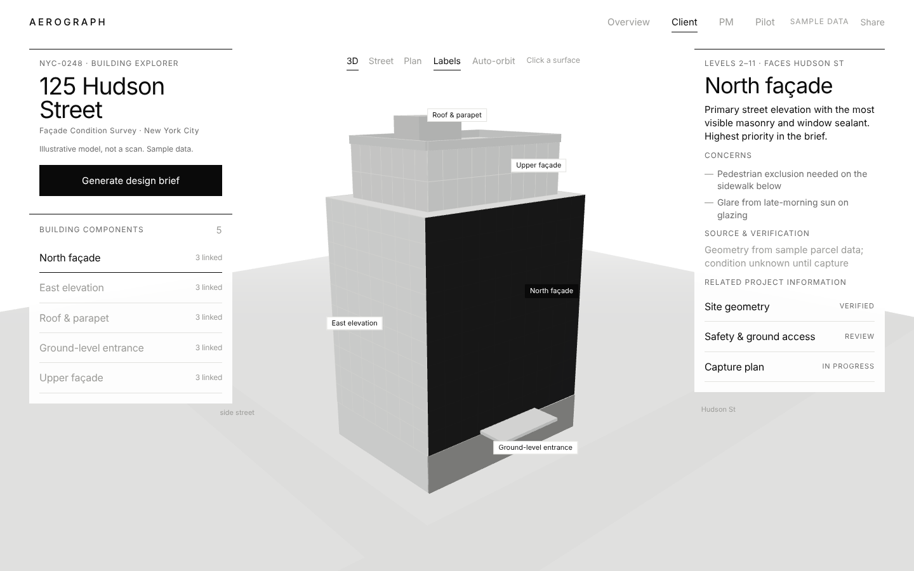
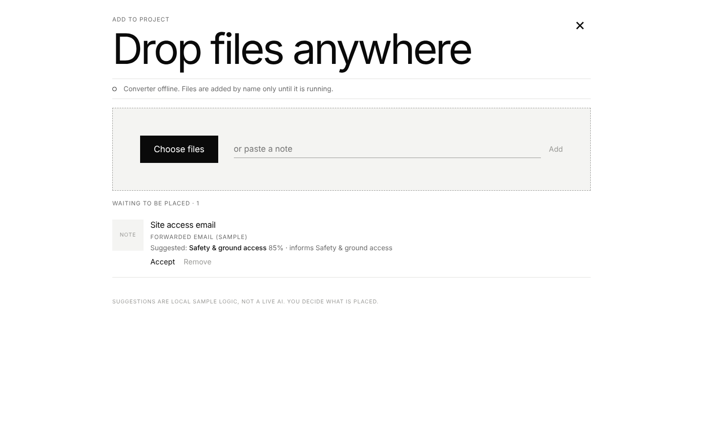
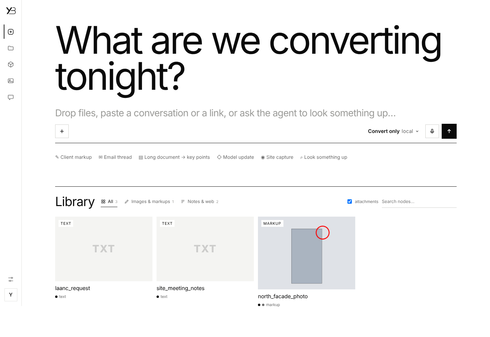
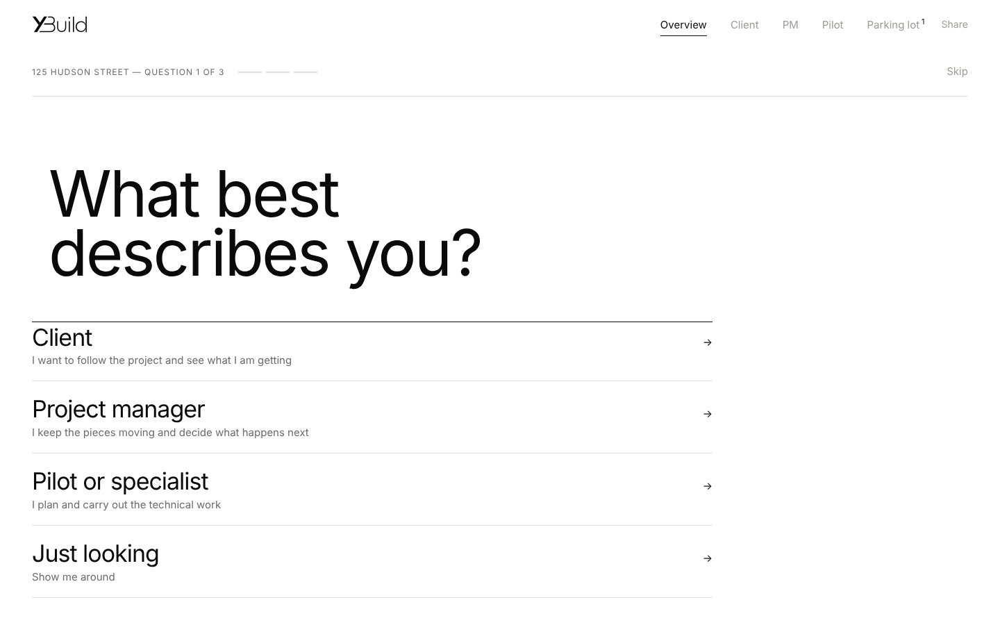
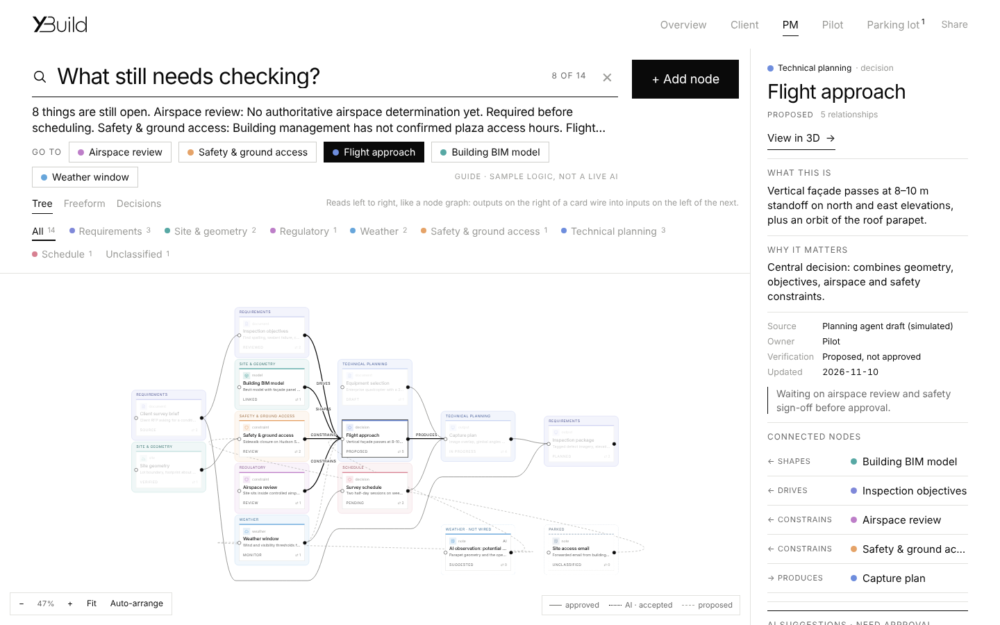

# YBuild (prototype)

Graph-based project management prototype for the fictional **125 Hudson Street façade condition survey** (project NYC-0248).
One in-memory project graph (14 nodes, 12 relationships, 4 AI-suggested links awaiting review) is shown through four views:

| View | For | What it does |
|---|---|---|
| **Overview** | everyone | Project twin board: node status table, open questions & proposed links (accept/dismiss), building twin, component × category matrix, category coverage, sample survey window, activity log |
| **Basic · Client** | client / proposal coordinator | Read-only 3D building explorer: 5 clickable components with concerns, verification and related nodes; **Generate design brief** (preview, copy, download `.md`) |
| **Medium · PM** | project manager | 2D hybrid canvas: draggable cards, Canvas / Graph / Decisions layouts, 7-category filter, search, zoom/fit/auto-arrange, add note, drop files into the inbox, node inspector with AI suggestions |
| **Expert** | pilot / technical expert | 3D knowledge network: orbit, zoom, click to inspect, labels, focus neighborhood, proposed links, reset view |

All data is **sample data**. No FAA, weather, BIM, scan, AI or email integration is live; those inputs are labelled as planned or simulated.
Changes (accepted links, moved cards, added notes) live only in the browser tab.

## Screens
| Overview | Client | PM tree |
|---|---|---|
|  |  |  |

| Expert | Add drawer | Converter page |
|---|---|---|
|  |  |  |

| Onboarding | Ask bar |
|---|---|
|  |  |

## Ask bar and onboarding
- **Ask bar (PM and Expert):** type a question in plain words ("What's blocking the flight?", "Who looks after safety?"). A short answer appears with "Go to" buttons for the matching nodes, and both views highlight them. The logic is in `src/features/ask.ts`: a local stand-in for an LLM, so no API key is needed. Replace `ask()` with a real model call that returns the same `AskResult` shape.
- **Survey (landing page):** the first thing anyone sees is a three-question survey (role, first goal, familiarity). No tab or feature opens until it is answered. It then lands on the page for the person's role: a client on Client, a project manager on PM, an expert on Expert, "just looking" on the Overview. Answers are stored in the browser only; the large **Retake questions** button at the end of the Overview brings the survey back.

## Adding files (drag and drop + converter)
Drag and drop works anywhere in the app. Dropped files are sent to the **converter** in [`../Minh/converter`](../Minh/converter), which turns each file into an embedding-ready package (text, images, audio, video chunks plus metadata). YBuild adds one node per package and shows it on the **+ Add** page under "Waiting to be placed", with a suggested category and link. Nothing joins the graph until you accept.

- **Dropping in 3D:** on the Expert tab, drop a file onto a node and it attaches to that node (the node highlights as you drag, and the new item appears next to it). On the Client tab, drop onto a part of the building. The scene stays visible; a bar at the bottom says what the file will attach to. Elsewhere a drop opens the full-screen **+ Add** page.
- Start the converter first (from `Minh/`): `python -m converter serve` (port 8765). In development Vite proxies `/api` and `/files` to it; set `VITE_CONVERTER_URL` to use another address.
- **AI reading:** when the converter's AI is available (`GET /api/agent`), each file goes to `POST /api/ask` and comes back with a title and a summary; a note typed on the + Add page is sent along as the prompt. If the AI is off, files go to `POST /api/convert` (local extraction, no summary). If the AI fails on one file, the file is still added, with a warning.
- **Folders:** drop a whole folder and every file inside is added, with its path inside the folder. Hidden files, Office lock files (`~$…`), `Thumbs.db`, `desktop.ini` and `.3dmbak .bak .tmp .part` files are skipped. The folder reader is `src/features/drop.ts`.
- **Large drops:** files are sent one per request, two at a time. Items appear under "Waiting to be placed" as they finish, with a progress line (`done / total`, failures) and a **Stop** button that sends nothing further. A failed file gets its own error row and does not hold up the rest.
- If the converter is not running, files are still added by name (plain-text files are read locally) and the drawer says "Converter offline".
- The placement suggestions come from `src/features/organize.ts`, a local keyword stand-in for an LLM. The converter itself only converts; it does not decide where things belong.
- The converter's own page (`Minh/converter/static/index.html`) uses the same YBuild look.

## PM tree layout
The default PM layout reads left to right like a Grasshopper canvas: output port on the right of a card, input port on the left of the next, wires routed through their own lanes so they never run behind a card, and same-category neighbours wrapped in a tinted group. Wires are always drawn.

## Brand
Logo files are in `src/assets/brand/` (full wordmark and YB monogram). The top bar uses the wordmark, switching to the monogram on narrow screens; the monogram is also the favicon. `src/components/Logo.tsx` holds inline copies so the logo follows the text colour.

## Design
One shared style file, `src/design/ui.css`: white page, black type, large display headings, hairline rules, numbered sections, arrow links. Status is shown as a word, not a colour. Category colour appears on the PM and Expert tabs only; those two tabs share one node search, category filter and selection. The building images in `src/assets/` are original renders of the illustrative model (regenerate with `?shot=north|east|roof|entrance|upper`).

## Run
```bash
npm install
npm run dev
```
Then open the printed address (usually http://localhost:5173). Views are linkable: `#overview`, `#client`, `#pm`, `#pilot`.

## Code map
- `src/data/sampleProject.ts`: categories + palette, nodes, edges, AI candidates, building components
- `src/model/graph.tsx`: shared graph store (select, move, accept/dismiss suggestion, add note/file)
- `src/features/generateDesignBrief.ts`: builds the Markdown brief from the graph
- `src/views/*`: Overview, Client, PM, Pilot
- `src/components/BuildingScene.tsx` (illustrative massing model), `NetworkScene.tsx` (3D graph), `ui.tsx` (inspector, badges, legend)

Moving a card or node never creates a relationship. AI suggestions become edges only when someone accepts them.
