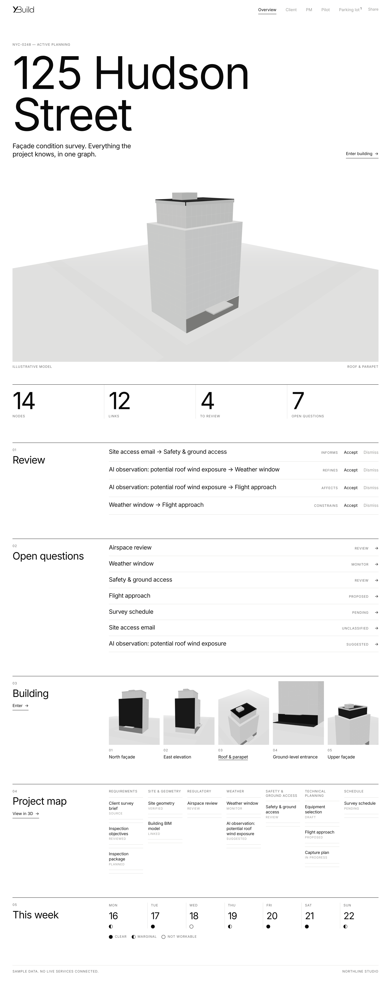
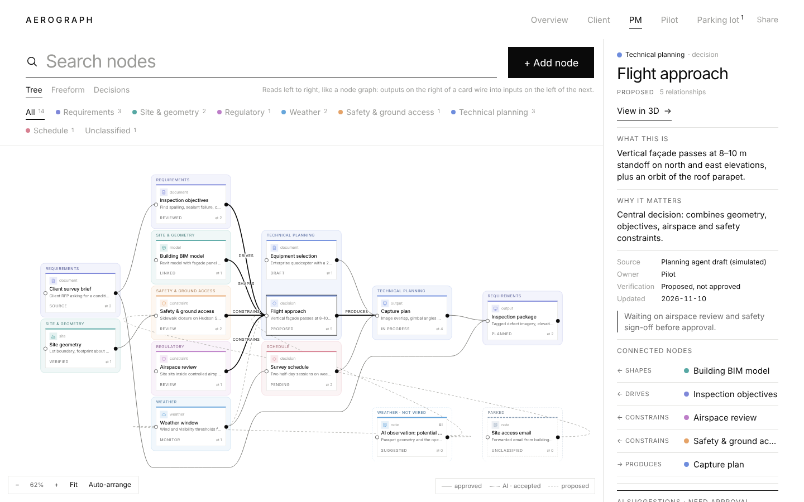
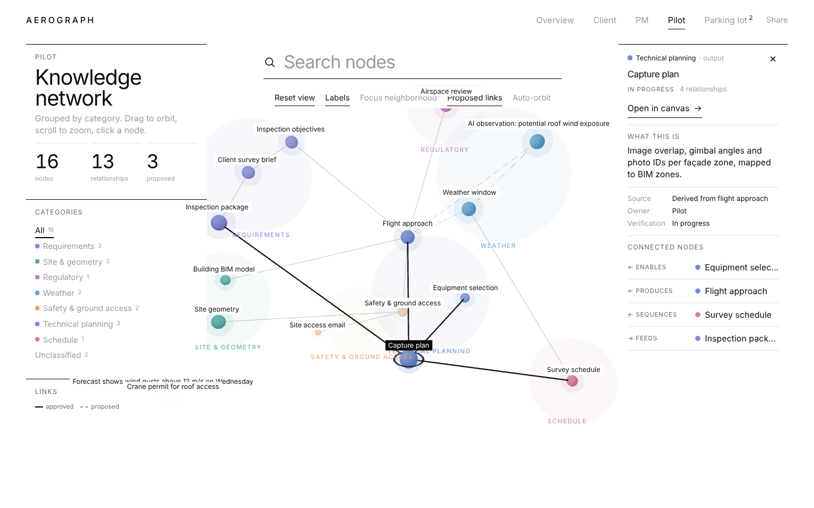
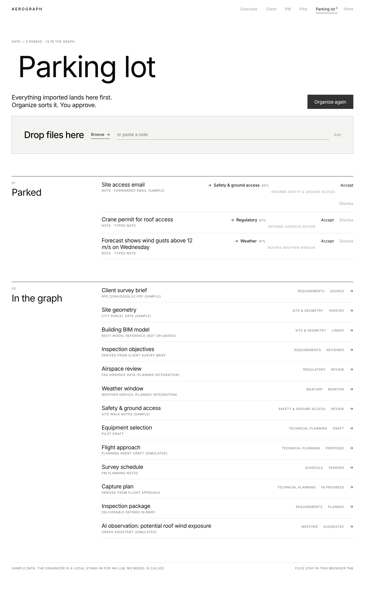

# YBuild (prototype)

Graph-based project management prototype for the fictional **125 Hudson Street façade condition survey** (project NYC-0248).
One in-memory project graph (14 nodes, 12 relationships, 4 AI-suggested links awaiting review) is shown through four views:

| View | For | What it does |
|---|---|---|
| **Overview** | everyone | Project twin board: node status table, open questions & proposed links (accept/dismiss), building twin, component × category matrix, category coverage, sample survey window, activity log |
| **Basic · Client** | client / proposal coordinator | Read-only 3D building explorer: 5 clickable components with concerns, verification and related nodes; **Generate design brief** (preview, copy, download `.md`) |
| **Medium · PM** | project manager | 2D hybrid canvas: draggable cards, Canvas / Graph / Decisions layouts, 7-category filter, search, zoom/fit/auto-arrange, add note, drop files into the inbox, node inspector with AI suggestions |
| **Advanced · Pilot** | pilot / technical expert | 3D knowledge network: orbit, zoom, click to inspect, labels, focus neighborhood, proposed links, reset view |

All data is **sample data**. No FAA, weather, BIM, scan, AI or email integration is live; those inputs are labelled as planned or simulated.
Changes (accepted links, moved cards, added notes) live only in the browser tab.

## Screens
| Overview | Client | PM tree |
|---|---|---|
|  |  |  |

| Pilot | Parking lot |
|---|---|
|  |  |

## Parking lot and organizer
Everything imported (dropped files, pasted notes, nodes added on the PM tab) lands in the **Parking lot** tab as an unclassified item. **Organize** proposes a category and links for each one; nothing joins the graph until you accept. The organizer in `src/features/organize.ts` is a local keyword stand-in for an LLM so the demo runs with no API key: replace the body of `organize()` with a real model call that returns the same `Suggestion` shape.

## PM tree layout
The default PM layout reads left to right like a Grasshopper canvas: output port on the right of a card, input port on the left of the next, wires routed through their own lanes so they never run behind a card, and same-category neighbours wrapped in a tinted group. Wires are always drawn.

## Brand
Logo files are in `src/assets/brand/` (full wordmark and YB monogram). The top bar uses the wordmark, switching to the monogram on narrow screens; the monogram is also the favicon. `src/components/Logo.tsx` holds inline copies so the logo follows the text colour.

## Design
One shared style file, `src/design/ui.css`: white page, black type, large display headings, hairline rules, numbered sections, arrow links. Status is shown as a word, not a colour. Category colour appears on the PM and Pilot tabs only; those two tabs share one node search, category filter and selection. The building images in `src/assets/` are original renders of the illustrative model (regenerate with `?shot=north|east|roof|entrance|upper`).

## Run
```bash
npm install
npm run dev
```
Then open the printed address (usually http://localhost:5173). Views are linkable: `#overview`, `#client`, `#pm`, `#pilot`.

## Code map
- `src/data/sampleProject.ts`: categories + palette, nodes, edges, AI candidates, building components
- `src/model/graph.tsx`: shared graph store (select, move, accept/dismiss suggestion, add note/file)
- `src/features/generateDesignBrief.ts`: builds the Markdown brief from the graph
- `src/views/*`: Overview, Client, PM, Pilot
- `src/components/BuildingScene.tsx` (illustrative massing model), `NetworkScene.tsx` (3D graph), `ui.tsx` (inspector, badges, legend)

Moving a card or node never creates a relationship. AI suggestions become edges only when someone accepts them.
