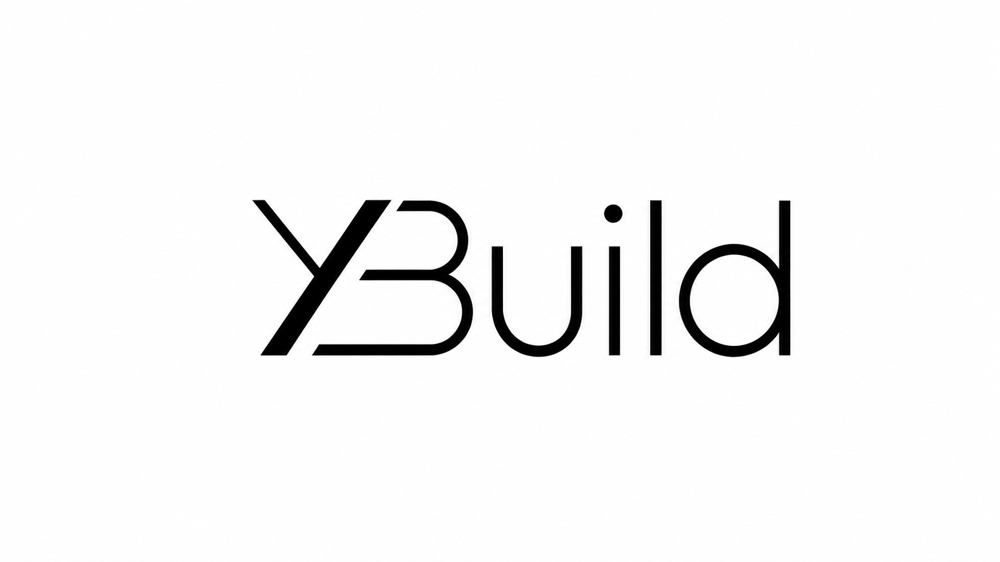

<p align="center"></p>

# YBuild: agentic and adaptable project management


A project system for complex project with many dependencies and risk factors such as drone flights, experimental fabrication and everything in-between. People add anything (files, notes, emails, a folder link), an AI proposes where it belongs in the project graph and what it affects, and a person approves. Every approved change is recorded with its source and reason, so the graph is also the project's decision history.

Built at the AEC Tech NYC Hackathon, November 2026.

## What it does

- **Add anything.** Drop files, paste text or point at a folder. The converter turns each item into text, images and metadata.
- **Propose, then approve.** The system suggests the node type, its links and what else would change. Nothing is placed until a person accepts it, one item at a time or in batches.
- **Explain consequences.** Plain-code rules flag what a change puts at risk (a permit, a flight window, a dependent task). An analysis loop can suggest new rules when asked.
- **Watch the outside world.** Live feeds for weather, airspace, city events, rule changes and space weather raise flags on the nodes that depend on them.
- **Views by role.** Technical expert, project manager and client each see the project at the level they decide on.
- **Several projects.** Each project runs as its own copy of the app with its own database; projects can be added and deleted from the page.

## Repository layout

| Path | What it is |
| --- | --- |
| [`src/northstar/`](src/northstar/) | The app: FastAPI back end, Postgres + pgvector schema, rules, live feeds, project launcher. Start here: [README](src/northstar/README.md). |
| [`src/web/`](src/web/) | The YBuild page, served by the app at `/app/`. Plain HTML, CSS and JavaScript, no build step. |
| [`src/converter/`](src/converter/) | File and link intake: any file to an embedding-ready package. [README](src/converter/README.md), [handoff notes](src/converter/HANDOFF.md). |
| [`src/monitors/`](src/monitors/) | The outside-world monitors behind the live feeds. [README](src/monitors/README.md). |
| [`src/api/`](src/api/) | `embeddings.py`, the shared embedding helper (local server or OpenRouter). |
| [`src/embedding-server/`](src/embedding-server/) | A small local embedding server (EmbeddingGemma). [README](src/embedding-server/README.md). |
| [`src/tools/`](src/tools/) | One-off scripts, such as the Rhino linework export used for the page background. |
| [`docs/`](docs/) | Design documents: [project brief](docs/PROJECT_BRIEF.md), [plan](docs/plan.md), [agent architecture](docs/agent-architecture.md), [data sources](docs/data-sources.md), use cases and mockups. |
| [`presentation/`](presentation/) | The pitch and the presentation pages. |
| [`archive/`](archive/) | Earlier prototypes and working notes, kept for reference. See [archive/README.md](archive/README.md). |

## Quick start

You need Docker (for Postgres), Python 3.12 and [uv](https://docs.astral.sh/uv/).

1. Copy the settings template and fill it in. Never commit `.env`; it is git-ignored.

   ```bash
   cp .env.example .env
   ```

2. Start Postgres.

   ```bash
   docker compose -f src/northstar/docker-compose.yml up -d db
   ```

3. Install the app and the converter.

   ```bash
   cd src/northstar && uv venv --python 3.12 && uv pip install -r requirements.txt -r ../converter/requirements.txt
   ```

4. Start the example project (run from `src/northstar`).

   ```bash
   ./run_project.sh east-tower
   ```

5. Open http://localhost:8100/app/.

`./run_project.sh` with no argument lists the projects and which are running. To run everything in Docker instead, and for the presentation mode, the API and the settings, see the [app README](src/northstar/README.md).

Embeddings come from either a local embedding server or OpenRouter, chosen in `.env`; see [`src/embedding-server/`](src/embedding-server/README.md).

## Team

Grant Saso, Ryan Sherman, Ecem Karaduman, Leslie Sheng, Minh Dang Ngo, Elcin Ertugrul, Sharare Norouzi, Ziyuan Feng, Polina Ustinova.
