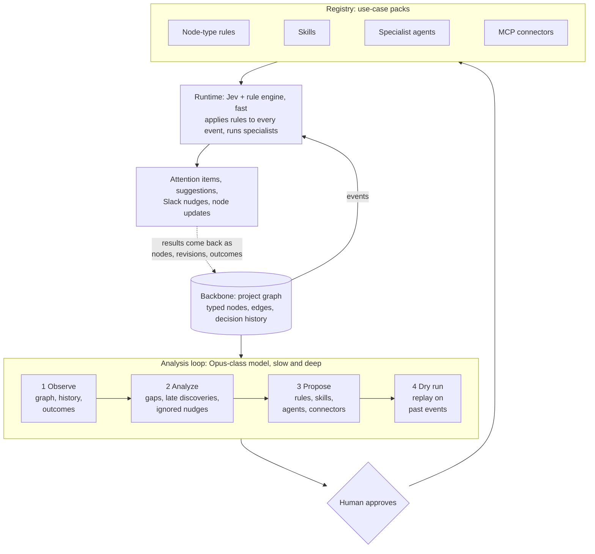

# Agent architecture: an analysis loop that builds specialists on top of the graph

_Draft for team critique · 2026-11-14 · companion to [plan.md](plan.md) and [usecase-facade-survey.md](usecase-facade-survey.md)_

**The idea in one paragraph.** The graph is the backbone. On top of it sits a collection of specialist agents, skills and connectors (MCPs), grouped into packs for a use case such as "facade survey in NYC". Nobody hand-writes all of that. A slow, deep **analysis loop** run by an Opus-class model (e.g. Claude Opus) studies the graph, the decision history and the use case, then proposes the specialists and the **rules for each node type**. A fast engine (Jev) and plain code apply those rules on every event. People approve what the loop proposes.

Everything here is **Proposed**.

## 1. Two speeds

| | Analysis loop | Runtime |
| --- | --- | --- |
| Model | Opus-class, deep reasoning | Jev (fast) + rule engine in code |
| Runs | At project start, at phase changes, after a surprise, and on a schedule (e.g. nightly) | On every event, in seconds |
| Reads | Whole graph, full decision history, outcomes of past rules and nudges | The event and the few nodes it touches |
| Produces | Rules, skills, agent definitions, connector choices, project templates | Attention items, suggestions, nudges, node updates |
| Human role | Approves or edits each proposal before it goes live | Approves or dismisses individual suggestions |



The dotted line closes the loop: what the runtime does lands back in the graph and its history, the analysis loop reads those results, and the next round of rules is better.

## 2. Node types and how each is managed

Every node has a type, and each type has its own life cycle. The rule engine treats them differently.

| Type | What it is | States | What the system does with it | Whiteboard example |
| --- | --- | --- | --- | --- |
| **Decision** | A choice someone must make | awaiting inputs → ready → decided → superseded | Tracks the upstream inputs it needs. Stays quiet while inputs are missing, chases those inputs, then surfaces the decision to its owner the moment it becomes ready. Records the outcome as a revision | "Pick the permit date": waits on scope, site visit and weather odds |
| **Discovery** | New information that may break an assumption | new → triaged → absorbed or dismissed | Finds what it touches (JSON and embedding match), asks Jev whether it invalidates anything, and re-opens affected decisions | "Airspace approval moved from FAA to DHS" |
| **Event** | Something that happens at a time | scheduled → imminent → happened or missed | Counts down, checks preconditions as it approaches, and marks dependents when it passes or slips | Flight day; the 5-day authorization window |
| **Data feed** | A live source that keeps updating | healthy, changed, stale, failed | Polls on a cadence that tightens near events, turns meaningful changes into discoveries, and warns when the feed goes stale | Weather forecast; airspace restrictions |
| **Deliverable** | Something owed to someone by a date | not started → in progress → in review → delivered | Tracks owner and due date; hands overdue ones to the messenger nanny | Permit package; photogrammetry maps |
| **Blocker / task** | Work waiting on a person or party | open → waiting → done | Tracks who it waits on and typical turnaround; nudges and escalates | Insurance proof from legal |
| **Constraint** | A rule or limit that others must satisfy | active, changed, expired | Checked against flights and plans whenever either side changes | Wind limit; NYPD 30-day rule |
| **Document / media** | Source material | placed or floating | Tagged, embedded, linked; mostly passive evidence | Site photos; flight plan drawings |

A node's type can change. A discovery that needs a response spawns a decision; a decision that is made may create deliverables and events.

**Decisions awaiting upstream inputs** deserve a note, because this is where projects stall. A decision node lists the inputs it needs (`needs: [...]`). The engine computes readiness from the state of those nodes. While it is not ready, the decision itself is not shown as urgent; instead the missing inputs are chased, each inheriting urgency from the decision's own deadline. When the last input lands, the decision is surfaced with its evidence attached.

## 3. Generated rules

Rules are **data, not code**: small JSON records the loop writes, a person approves, and the engine evaluates. Cheap conditions run in code; anything needing judgment is passed to Jev with a focused prompt.

```json
{
  "rule": {
    "id": "rule_031",
    "pack": "nyc-facade-survey",
    "applies_to": {"type": "decision", "tags": ["permit-date"]},
    "when": "state == 'awaiting_inputs' and days_until(deadline) <= sum(lead_time_days of missing inputs) + 3",
    "then": [
      {"action": "raise_attention", "level": "red", "for": ["pm", "pilot"]},
      {"action": "nudge_owners_of", "target": "missing_inputs", "via": "messenger_nanny"}
    ],
    "judgment": null,
    "why": "On past facade jobs the permit date slipped because inputs arrived after the 30-day cutoff",
    "written_by": "analysis_loop",
    "evidence": ["rev_7", "rev_13"],
    "status": "proposed | dry_run | active | retired",
    "approved_by": null,
    "stats": {"fired": 0, "acted_on": 0, "dismissed": 0}
  }
}
```

Examples the loop might generate for the facade survey, one per node type:

| Node type | Rule in plain words |
| --- | --- |
| Decision | If a permit-date decision is still waiting on inputs and the time left is less than the inputs' lead times plus 3 days, go red and nudge the input owners |
| Discovery | If a new regulation notice is close in meaning to an active permit node, ask Jev whether requirements changed; if yes, re-open the permit package and tell the pilot |
| Event | When a flight is 72 hours out, re-check weather, crew confirmations and permit validity; any failure raises a blocker |
| Data feed | Poll weather daily; switch to hourly inside 72 hours of a flight; if the feed is silent for 6 hours in that window, warn |
| Deliverable | After the first test flight, run the metadata check skill on the upload before any further flights are scheduled |
| Constraint | When a wind limit changes, re-evaluate every scheduled flight against the forecast |

How a rule goes live:

1. **Proposed** by the loop, with its reason and the history that motivated it.
2. **Dry run:** replayed against past events to show what it would have fired on, and what it would have missed.
3. **Approved** by a person (pilot or PM, depending on the rule). Approval is a revision.
4. **Active**, with counters for fired, acted on and dismissed.
5. **Tuned or retired** by the loop when it is ignored or wrong, again with approval.

## 4. Skills, agents and connectors

Three kinds of building block, held in a registry and bundled into **packs** per use case.

| Block | What it is | Examples for the facade survey pack |
| --- | --- | --- |
| **MCP connector** | A standard plug into an outside system; gives agents tools and data | Slack, email, weather, FAA airspace, maps, file storage, calendar |
| **Skill** | A packaged how-to: instructions plus the tools it needs, for one kind of task | Assemble a permit package; pick a flight window; check image metadata; write a client update; read a regulation notice |
| **Specialist agent** | A role with a goal, a set of skills and connectors, and the node types it owns | Permit coordinator; scheduler; data QA; messenger nanny; client liaison |

- **A pack** = node-type rules + skills + agents + connectors + a project template (phases, checklists, lead times). "NYC facade survey" is one pack; "construction monitoring" would share most connectors but have different rules and skills.
- **The loop builds packs.** Given a new use case, it starts from the nearest existing pack, reads the example projects and the experts' answers, and proposes what to add or change. It can draft a new skill when it sees the same manual work repeated, like the metadata fix on the whiteboard.
- **Specialists are thin.** They don't hold state; the graph does. An agent wakes on a rule, reads the nodes it needs, uses its skills, writes results back as nodes and revisions, and stops.

## 5. What triggers the analysis loop

- **Project start:** choose and adapt a pack; pre-load the template.
- **Phase change:** e.g. entering permitting, load the rules and skills that phase needs.
- **A surprise:** a discovery that no rule caught, a missed deadline, a loop back to an earlier phase. The loop asks "what rule or feed would have caught this earlier?" and proposes it.
- **Feedback signals:** rules that fire and get dismissed, nudges that are ignored, suggestions that are always edited the same way.
- **On a schedule:** a nightly review, and a retrospective at project end that updates the pack for next time.

## 6. Guardrails

- **Nothing the loop writes is live until a person approves it.** Rules, skills and agents all go through proposed → dry run → approved.
- **Every rule explains itself:** its reason and evidence are stored, and every attention item names the rule that raised it.
- **Agents have scoped permissions:** which node types they can write, which connectors they can use, and whether they can message people or only draft.
- **Cost control:** the Opus-class loop runs rarely and on summaries; the per-event work is code and Jev.
- **Rules are versioned in the decision history,** so "why did the system start doing this?" always has an answer.

## 7. Hackathon slice

Building the full loop is too much for a weekend. A convincing slice:

1. Hand-write the node types and a small rule engine that evaluates JSON rules.
2. Seed the facade survey pack with 5 or 6 rules from the table above.
3. Run the analysis loop **once, live**: give the Opus-class model the whiteboard project history and ask for new rules. Show one proposal, its dry run against the replay, and approve it on screen.
4. Show that rule firing later in the replay.

## 8. Open questions

1. **Models:** which Opus-class model and through which route (OpenRouter with the team key, or direct)? What is Jev's exact ID?
2. **Rule language:** how expressive should `when` be? A tiny expression language is safe and explainable; free-form prompts are flexible but harder to trust.
3. **Who approves what?** Pilot for technical rules, PM for people and schedule rules?
4. **Skill format:** do we adopt an existing skill and MCP format so real connectors plug in, or mock them for the demo?
5. **Node types:** is the list in section 2 right? What's missing for inspection, monitoring and manufacturing?
6. **For the drone experts:** which rules of thumb do you already follow that we should seed the pack with? Which would you never want automated?
