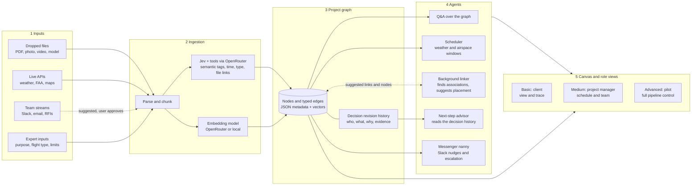
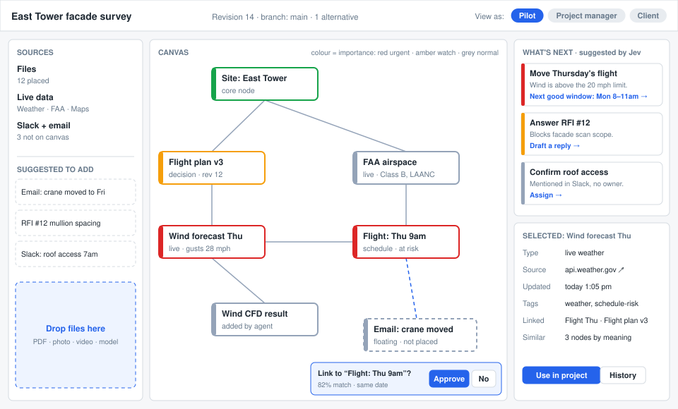
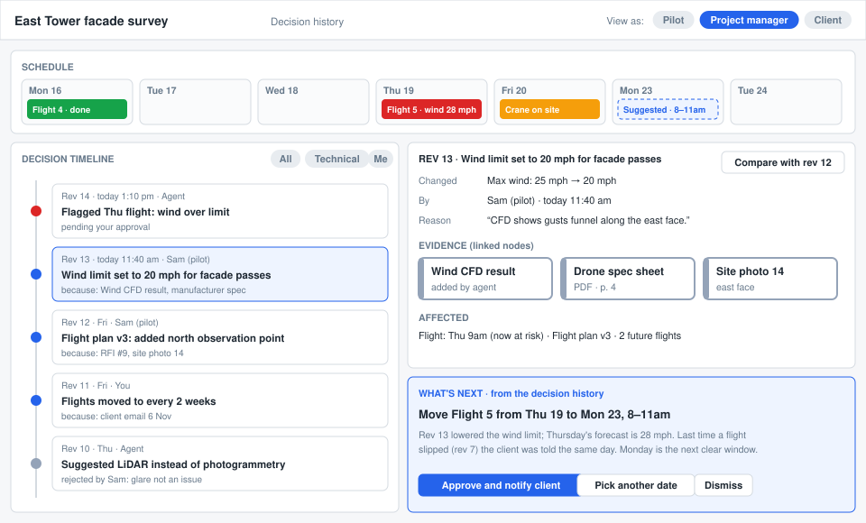
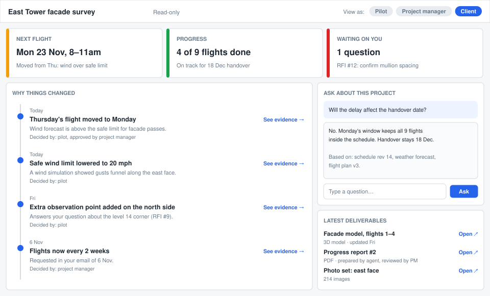

# Plan: Drone Project Management

_Draft for team critique · 2026-11-14 · background in [PROJECT_BRIEF.md](PROJECT_BRIEF.md)_

**Worked example:** [usecase-facade-survey.md](usecase-facade-survey.md) walks a real facade survey through the system and proposes how it decides what to surface to whom, and when (the "attention engine"), plus a Slack "messenger nanny" that chases deliverables and dropped balls.

**How to use this doc:** nothing here is final. Each section is marked **Decided**, **Proposed** or **Open**. Challenge anything marked Proposed, and answer what you can in sections 11 and 12.

## 1. What we're building

A project system for drone flight work (surveys, inspections, monitoring). Users drop files and data onto a canvas. The system turns each item into a node in a knowledge graph, links related nodes, keeps a revision history of every decision, and gives each role a view matched to what they can decide.

**The demo we're aiming for (Proposed):**

1. A pilot drops a site photo, a PDF and a schedule onto the canvas.
2. Each becomes a node, tagged by Jev and linked to related nodes.
3. Live weather and airspace data arrive as nodes on their own.
4. An agent flags a conflict, e.g. "Thursday's flight is in a wind window above the limit", and suggests the next good date.
5. The pilot approves. The change is recorded as a decision revision: who, what, why, and the evidence it rested on.
6. Jev reads the revision history and suggests what comes next, e.g. "notify the client, as you did last time a flight moved".
7. The same project is shown in the client view (read-only, decisions traced) and the pilot view (full control).

## 2. System outline



Read it left to right: inputs are parsed, then described two ways (Jev and its tools write the tags and metadata, the embedding model captures the meaning) and stored in one graph. Every decision made on that graph is kept as a revision. Agents read both the graph and the decision history, and feed the three role views. Dotted lines are suggestions that a person approves. Not drawn, to keep it readable: anything a user edits, approves or drops on the canvas goes back through ingestion.

## 3. Decision revision history (Proposed, core feature)

The record of **what was decided, by whom, why, and on what evidence** is a headline feature, not a side effect of version control.

- **A revision is one decision.** Examples: a wind limit changed, a flight moved, an observation point added, an agent suggestion approved or rejected.
- **Each revision stores:** who made it (person or agent), when, what changed (before and after), the stated reason, and links to the evidence nodes it rested on.
- **Rejected suggestions are kept too,** with the reason. "We considered LiDAR and said no because..." is part of the record.
- **Alternatives are branches.** A pilot can try "what if we fly Monday instead" without committing; choosing one becomes a revision.
- **Each role reads it differently:** the client sees a plain-language "why things changed" feed, the PM sees the full timeline with evidence, the pilot can compare and roll back.

**Next-step advisor.** Jev (or an agent built on it) reads the revision history plus the current graph and suggests what the user should do next, shown as a "What's next" panel in every view. It can draw on:

- **Consequences:** "rev 13 lowered the wind limit, so Thursday's flight is now at risk".
- **Patterns:** "the last time a flight moved, the client was notified the same day".
- **Gaps:** an open RFI that blocks a scheduled flight, a decision with no owner, a suggestion waiting for approval.

Suggestions are always proposals. A person approves, edits or dismisses them, and that response becomes a revision too.

## 4. Hybrid tagging and background associations (Proposed)

Each item gets described three ways, and a background job combines them to find links.

| Layer | Made by | What it holds | Good for |
| --- | --- | --- | --- |
| Semantic tags | Jev | Topic tags and a one-line summary in the node's JSON, e.g. `weather`, `schedule-risk`, `facade` | Filtering, grouping, explaining why two things relate |
| Hard metadata | Jev calling tools | Time, type, author, location, and links to the real file or site (file path, URL, Slack permalink, API source) | Exact matches: same date, same place, same file, same sender |
| Embedding | Embedding model | A vector for the item's meaning, across text, images and video | Finding related items nobody tagged the same way |

**Tools Jev can call** while tagging (first list, to be extended): read file properties and EXIF (time, GPS), extract dates and places from text, resolve a link to its title and source, look up an address on the map.

**Background linker.** A job that runs after each new node and periodically over the whole graph. It proposes an edge when signals agree, for example shared tags + overlapping dates + close embeddings. Each proposed edge records its origin, a confidence score, and a one-line reason ("same date, mentions crane"). High-confidence links are added automatically; the rest appear as suggestions to approve, as in the pilot mockup below.

## 5. Interface mockups (Proposed, for front-end critique)

These are sketches to react to, not designs. All three show the same project and the same moment: a wind forecast has put Thursday's flight at risk.

**Advanced view: pilot canvas.** Sources and drop zone on the left, the graph in the middle with nodes coloured by importance, a floating node with a suggested link, and "What's next" plus node details on the right.



**Medium view: project manager decision history.** Schedule strip on top, the decision timeline on the left, and the selected revision on the right with its reason, evidence and a suggested next step drawn from the history.



**Basic view: client.** Read-only. Three status cards, a plain-language "why things changed" feed with evidence links, a question box answered from the graph, and deliverables.



## 6. Technical choices

| Area | Choice | Status |
| --- | --- | --- |
| Fast decision engine | **Jev through OpenRouter**: tagging, metadata via tools, link types, importance, Q&A, next-step suggestions | Decided (exact OpenRouter model ID: Open) |
| Model access | One team OpenRouter API key, kept in `.env`, never committed | Decided |
| Local development | Everything runs with `docker compose up` | Decided |
| Embeddings | Behind one swappable interface; model choice in section 7 | Open |
| Backend | Python + FastAPI | Proposed |
| Storage | Postgres + pgvector: nodes, edges and vectors in one database | Proposed |
| Decision history | Append-only revision log per project in the database (section 3); branches for alternatives if time allows | Proposed |
| Front end | Canvas + graph view; framework is the front-end team's call | Open |

## 7. Embedding model options

All calls go through one function, so we can switch. But vectors from different models can't be mixed: **switching means re-embedding everything, so we should pick by the end of day 1.**

Prices are OpenRouter's list prices today, per million input tokens.

| Option | Handles | Price | Notes |
| --- | --- | --- | --- |
| `google/gemini-embedding-2` | Text, image, video, audio, files | $0.20 | Only hosted option covering video and audio natively |
| `amazon/titan-embed-text-v2` | Text only | $0.02 | Cheapest solid text option; images would need a second model |
| `amazon/titan-embed-image-v1` | Text + image | $0.80 | 128-token input limit, so poor for documents |
| `cohere/embed-5-fast` | Text + image | $0.08 | Very long inputs (128k tokens) |
| `mongodb/voyage-multimodal-3.5` | Text + image | $0.12 | Built for mixed text-and-image pages |
| `nvidia/nemotron-3.5-embed-1b:free` | Text + image | Free | Free tier; rate limits unknown |
| Local EmbeddingGemma 2 | Text, image, video, audio | Free | Already running on Ryan's M4 Air; measured ~17 text chunks/s, ~1 image/s. Works offline |

**Proposed:** start on `google/gemini-embedding-2` because drone footage and site photos are core inputs. Keep local EmbeddingGemma 2 as the "works offline, data stays on the laptop" story. If we decide video isn't needed for the demo, Titan text v2 or Cohere embed-5 are cheaper.

**Docker caveat for the local model:** Docker on a Mac can't use the Apple GPU, so EmbeddingGemma 2 inside a container would run on CPU only and be much slower. If we use it, it runs directly on the Mac and the containers call it at `host.docker.internal:8000`.

## 8. Local development with Docker

Proposed `docker-compose.yml` services:

| Service | What it is | Port |
| --- | --- | --- |
| `web` | Front end (canvas, graph, role views) | 3000 |
| `api` | FastAPI: ingestion, graph queries, agents, calls to OpenRouter | 8080 |
| `db` | Postgres + pgvector | 5432 |
| `nanny` | Slack agent (Socket Mode, no public URL needed): nudges, follow-ups, escalation | none |
| `worker` | Background jobs: polling weather and FAA, embedding large uploads, the background linker | none |

- Setup for a new teammate: clone, copy `.env.example` to `.env`, paste the OpenRouter key, run `docker compose up`.
- Code is mounted into the containers so edits reload without rebuilding.
- `EMBEDDING_PROVIDER=openrouter|local` and `EMBEDDING_MODEL=...` in `.env` pick the embedding model.

## 9. Data model sketch (Proposed)

```json
{
  "node": {
    "id": "n_102",
    "kind": "document | decision | weather | regulation | rfi | message | model | flight | ai_artifact",
    "title": "Wind forecast, Thu",
    "source": {"type": "api", "ref": "weather", "fetched_at": "2026-11-14T13:00Z"},
    "tags": ["weather", "schedule-risk"],
    "summary": "Gusts to 28 mph Thursday morning",
    "time": {"start": "2026-11-19T08:00", "end": "2026-11-19T12:00"},
    "links": ["https://api.weather.gov/..."],
    "importance": 0.8,
    "needs_decision": false,
    "placed": true,
    "created_by": "agent | user id",
    "embedding_ref": "vec_102"
  },
  "edge": {
    "from": "n_102",
    "to": "n_045",
    "type": "constrains | supports | supersedes | answers | derived_from | similar_to",
    "origin": "jev | embedding | metadata | user",
    "confidence": 0.74,
    "reason": "same date, both mention wind",
    "approved": false
  },
  "revision": {
    "id": "rev_13",
    "at": "2026-11-14T11:40Z",
    "by": "user id | agent",
    "kind": "decision | suggestion_approved | suggestion_rejected | edit",
    "title": "Wind limit set to 20 mph for facade passes",
    "change": {"node": "n_045", "field": "max_wind_mph", "before": 25, "after": 20},
    "reason": "CFD shows gusts funnel along the east face",
    "evidence": ["n_088", "n_031"],
    "parent": "rev_12",
    "branch": "main"
  }
}
```

- `placed: false` is a floating node waiting for a home.
- `importance` drives node "temperature" (colour); users can override it.
- `origin` records whether Jev, embedding similarity, a metadata match or a person made the link.
- `revision.parent` chains revisions into a history; `evidence` points at the nodes a decision rested on.

## 10. Build order

| Phase | Outcome | Depends on |
| --- | --- | --- |
| 0. Skeleton | `docker compose up` gives an empty canvas, API and database | Nothing |
| 1. Drop to node | Drop a file, get a tagged, embedded node on the canvas | Jev model ID, embedding choice |
| 2. Links | Background linker connects related nodes; floating nodes get placement suggestions | Phase 1 |
| 3. Decision history | Every change and approval is saved as a revision with reason and evidence; timeline view | Phase 1 |
| 4. Live data | Weather and one airspace source appear as nodes | SME answers in section 12 |
| 5. One agent | Scheduler flags a bad flight window and proposes a date | Phases 2, 4 |
| 6. What's next | Jev reads the revision history and suggests the next step | Phases 3, 5 |
| 7. Role views | Client, PM and pilot views of the same project | Front-end answers in section 12 |
| 7b. Attention engine | Events are matched to the graph, scored for urgency and impact, and surfaced by level (flashing red to grey). See the worked example | Phases 3, 4 |
| 7c. Messenger nanny | Slack agent DMs owners about due items and dropped balls, then escalates to the PM. See the worked example, section 4 | Phase 7b, Slack app install |
| 8. Stretch | Slack-watching agent, Q&A, branches for alternatives, 3D graph | Time |

Meanwhile, the three example project cards (inspection, monitoring, manufacturing) feed phases 1 to 6 with realistic test data, including a believable decision history for each.

## 11. Open questions: technical

1. **Jev:** what is its exact model ID on OpenRouter, and is it fast and cheap enough to tag every dropped item?
2. **Embeddings:** do we need video and audio in the demo? That decides Gemini Embedding 2 versus a cheaper text + image model.
3. **Node placement:** tags, a fixed phase/task hierarchy, or free placement with suggestions? What are the "core nodes" every project starts with?
4. **Decision history:** what counts as a decision worth a revision? Captured automatically on every change, or only when someone states a reason? Is a linear log enough for the demo, or do we need branches to show "explore alternatives"?
5. **Scope:** is canvas + decision record + agents too much? Which one is the headline?
6. **Sharing:** one shared hosted demo, or does everyone run it locally?
7. **Auto-linking:** above what confidence does the background linker add a link without asking? How do we stop the graph filling with weak links?
8. **What's next:** how many suggestions at once, and how do we keep them from being noise? Does history from one project inform suggestions on another?
9. **Jev's tools:** which tools does it need first, and can the tagging call stay fast with tool use?

## 12. Questions for front end and drone subject experts

**Drone operations (please answer from real projects):**

1. What makes a flight go or no-go? Rough limits for wind, rain, visibility, temperature, and how they differ by flight type.
2. Which airspace checks do you actually do before a flight (authorizations, temporary restrictions), and where do you look them up today?
3. Walk us through one real project: what documents and messages existed, and which ones actually changed a decision?
4. What decisions get made, by whom, and what would a client want to trace afterwards?
5. What goes wrong most often: rescheduling, missing permissions, bad data, scope changes?
6. What do you hand over at the end (models, images, reports), and what would you want the AI to prepare for you?
7. For the three example cards, what inputs are essential for inspection versus monitoring versus manufacturing?
8. When a decision is questioned months later (by a client, insurer or regulator), what do you need to be able to show? Does that set what a revision must record?
9. Give us two or three real "what should happen next" moments: after a flight slips, after a failed capture, after a scope change. What does a good pilot or PM do next?

**Front end and client view:**

1. What must each role see first when they open a project? One sentence per role.
2. Is the canvas the main screen for everyone, or only for the pilot, with simpler dashboards for client and PM?
3. How should a suggestion look and be approved: a card, a ghost node, a side panel?
4. Graph in 2D like Obsidian or 3D clusters: which reads better in a 3-minute demo?
5. How do we show node importance and time-sensitivity without clutter?
6. What does the API need to return for the canvas to work? A first list of calls would let the backend start.
7. React to the three mockups in section 5: what's missing, what's too much, and what would you change first?
8. Where should "What's next" live: a side panel, the top of the page, or a notification? How does a user say "not now"?
