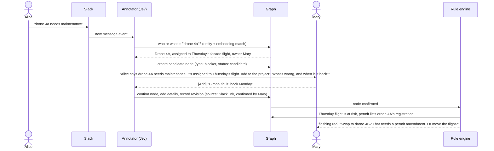

# Use cases, demo target, and backbone decisions

_Draft for team critique · 2026-11-14 · companion to [plan.md](plan.md), [usecase-facade-survey.md](usecase-facade-survey.md) and [agent-architecture.md](agent-architecture.md)_

Three parts: (1) concrete use cases, starting with Slack intake; (2) what would be impressive to finish this weekend; (3) the backbone decisions we need to make, each with a recommendation to argue with.

## 1. Use cases

### 1.1 Slack intake: "drone 4a needs maintenance"

Alice posts a passing remark in Slack. It should not silently enter the graph, and it should not be lost. It becomes a **candidate**, and the agent asks the right person to confirm and fill in details.



What makes this more than a chatbot:

- **Entity resolution.** "drone 4a" is matched to the Drone 4A node the project already knows, so the system knows which flight it affects.
- **A candidate is not a fact.** It sits in an inbox state until a person confirms. Mary can answer Add, Not relevant, or Already known.
- **The right person is asked.** The owner of the matched node, falling back to the PM. Here that is Mary, not Alice. (Assumption to confirm: Mary is the equipment or project owner.)
- **Consequences follow automatically.** Once confirmed, the rules find the downstream effects: the flight, and the permit forms that name this drone's registration.
- **It's all on the record.** The revision shows where the information came from, who confirmed it, and what changed as a result.

### 1.2 Other use cases in the same pattern

Each follows the same path: **something arrives → annotator makes a candidate or node → matched to the graph → rules decide what it means → the right person is asked or told.**

| # | Trigger | What the system does | Node type |
| --- | --- | --- | --- |
| 1 | Client email: "can you also cover the north elevation?" | Candidate scope change. Asks the PM. If accepted: re-opens flight plan and permit decisions, states the cost in days | Decision |
| 2 | Someone forwards a city notice about airspace restrictions | Matches it by meaning to the permit node; asks the pilot whether requirements changed | Discovery |
| 3 | Site visit photo dropped on the canvas, GPS in its metadata | Pinned to the site location; annotator notices scaffolding on the east face; asks the pilot if it blocks the flight path | Discovery |
| 4 | Updated 3D model dropped | Adapter renders views and extracts text (Minh's work); compared with the previous version; "roof parapet height changed, check take-off spot" | Discovery |
| 5 | "I'll send the flight plan tomorrow" in Slack | Recorded as a commitment with owner and date; the nanny follows up if it lapses | Blocker |
| 6 | "Can we still fly Thursday?" asked in Slack | Answered in-thread from the graph, with the evidence: forecast, permit window, crew, equipment | none (Q&A) |
| 7 | Client opens the client view: "why did the date move?" | Plain-language trace through the decision history | none (trace) |
| 8 | Weather feed updates | Flight event goes at-risk; next good window proposed | Event |
| 9 | Crew member's calendar shows leave on flight day | Blocker raised to the PM with alternatives | Blocker |
| 10 | Permit status email arrives | Authorization event created with its validity window; schedule strip updates | Event |
| 11 | Flight images uploaded | Metadata check skill runs before more flights are booked | Deliverable |
| 12 | Two documents disagree (wind limit 20 vs 25 mph) | Contradiction flagged; asks the pilot which stands; loser is marked superseded | Decision |
| 13 | Meeting transcript dropped | Decisions, action items and open questions extracted as candidates for the group to confirm | Mixed |
| 14 | New project of a familiar kind starts | Template from past projects: checklist, lead times, "what caused rework last time" | Mixed |

Use case 13 is worth noting: **we can dogfood it this weekend.** Our own Slack channel and discussion transcripts are a ready-made test set.

### 1.3 Adapters: turning any file into things the embedding model can read

- **Now (Minh):** each file type gets an adapter that pulls out images and text the embedding model handles natively. A 3D model becomes rendered views plus element names and properties; a PDF becomes page text and page images; a video becomes keyframes.
- **Proposed contract,** so adapters plug into the backbone without coordination:

```json
{
  "source": {"file": "tower.rvt", "type": "3d_model", "hash": "..."},
  "metadata": {"created": "2026-11-02", "author": "...", "location": {"lat": 40.7, "lon": -74.0}},
  "parts": [
    {"kind": "image", "path": "views/east-elevation.png", "label": "East elevation", "pointer": {"view": "east"}},
    {"kind": "text", "text": "Level 14 curtain wall, mullion spacing 1.5 m", "pointer": {"element_id": "..."}}
  ]
}
```

- Each part keeps a **pointer** back to where it came from (page, view, element, timestamp), so a search hit can open the right spot in the original.
- **Later: an adapter-builder agent.** Given an unknown file type, it inspects the file, tries available libraries and tools, writes an adapter, tests it against the contract, and proposes it for approval. This is the analysis loop pattern applied to ingestion.

## 2. What would be impressive to finish

**Recommendation: one live story, end to end, rather than many half features.** The story is the facade survey, and the hero moment is the Slack intake, because the audience can watch it happen in real time.

### The 3-minute demo

1. **Drop.** Drag a site photo, a permit PDF and a 3D model onto the canvas. Three typed, tagged nodes appear and link themselves to the project. _(Shows: adapters, annotator, embeddings, graph.)_
2. **Slack.** Someone types "drone 4a needs maintenance" in Slack. The agent asks Mary in a DM; she taps Add and types a line. A node appears on the canvas, and Thursday's flight starts flashing red. _(Shows: intake, candidates, entity resolution, rules, attention.)_
3. **Decide.** The pilot clicks the suggestion "move to Monday", types a reason, approves. The decision timeline gains a revision with its reason and evidence. _(Shows: revision history.)_
4. **Switch role.** Flip to the client view: "Flight moved to Monday: equipment maintenance." No graph, no jargon. _(Shows: role views.)_
5. **Close the loop.** The analysis loop proposes a new rule: "when equipment is reported faulty, check permits that name it." Approve it on screen. _(Shows: the system improves itself.)_

### Tiers

| Tier | Feature | Why it matters |
| --- | --- | --- |
| **Must** | Typed nodes with tags, embeddings and links, visible on a canvas | Without this there is no backbone to show |
| **Must** | Slack intake with confirm-in-Slack, live update on the canvas | The hero moment; proves it works where people already talk |
| **Must** | Decision history: revisions with reason and evidence | The team's stated core feature |
| **Must** | One rule that turns a node red for a real reason | Proves "surfacing", not just storing |
| **Should** | Role switch: pilot canvas vs client feed | Cheap to build on the same data; strong for AEC judges |
| **Should** | "What's next" suggestion from history | One Jev call over the revision log |
| **Should** | 3D model ingestion through an adapter | Distinctly AEC; depends on Minh's progress |
| **Could** | Analysis loop proposing one rule live | The "wow, it writes its own rules" beat |
| **Could** | Nanny escalation; replay of the whiteboard project as a timeline | Great if time allows; easy to fake badly |
| **Later** | Adapter-builder agent, branches, 3D graph view, real FAA and permit feeds | Mention as roadmap |

**Honest risks:** live Slack needs an app installed in a workspace we control; live demos of LLM calls can lag, so keep a recorded fallback; seeded data must be believable, which needs the drone experts for an hour.

## 3. Backbone decisions

Each has a recommendation so we can disagree with something concrete. **Owner** is blank for the team to fill in.

### 3.1 Embedding system

| # | Decision | Options | Recommendation | Owner |
| --- | --- | --- | --- | --- |
| E1 | Which model | Gemini Embedding 2 on OpenRouter; a cheaper text + image model; local EmbeddingGemma 2 | Gemini Embedding 2. Decide today: changing later means re-embedding everything | |
| E2 | What gets a vector | Whole file; each part (chunk, page, view); the annotator's summary | Both: every part, plus one "card" vector per node made from its summary and tags. Parts find details; cards link across types | |
| E3 | Where vectors live | pgvector in Postgres; a separate vector database | pgvector. One database, one backup, joins with node metadata | |
| E4 | Adapter contract | Each adapter does its own thing; one shared output shape | Shared shape (section 1.3). Agree with Minh now | Minh |
| E5 | When similarity becomes a link | Fixed threshold; top-k neighbours; Jev confirms each | Top-k neighbours as suggestions, Jev confirms the strongest; tune the threshold on real data | |

### 3.2 Annotator agent

| # | Decision | Options | Recommendation | Owner |
| --- | --- | --- | --- | --- |
| A1 | Output shape | Free text; strict JSON schema | Strict schema: type, summary, tags, entities, time, links, confidence. Reject and retry on invalid output | |
| A2 | Tag vocabulary | Free tags; fixed list; both | Small fixed list for things rules depend on (permit, weather, equipment, schedule) plus free tags | |
| A3 | Entity resolution | None; string match; registry of known entities | A registry of people, equipment, places and permits, matched by name and embedding. "drone 4a" must resolve to one node | |
| A4 | Auto-add vs ask | Everything auto; everything asks; by source | By source: dropped files and data feeds are added directly; Slack, email and anything inferred become candidates | |
| A5 | Who gets asked | The poster; the matched node's owner; the PM | Owner of the matched node, PM as fallback, poster only for missing details | |
| A6 | Which model | Jev for everything; a stronger model for hard cases | Jev by default; escalate to a stronger model when confidence is low | |

### 3.3 Revision system

| # | Decision | Options | Recommendation | Owner |
| --- | --- | --- | --- | --- |
| R1 | What is recorded | Only decisions; every change to the graph | Every change as an append-only event; decisions are the events that carry a reason and evidence. The current graph is the result of replaying the log | |
| R2 | Real Git or a database log | Git repository per project; event table in Postgres | Event table. Git is awkward for a live multi-user graph; we still get history, diff and replay | |
| R3 | Branches for alternatives | Full branching; a "scenario" label; none | A scenario label on events for the demo; real branching later | |
| R4 | Capturing the reason | Optional; required; drafted by Jev | Required for decisions; Jev drafts it from context and the person edits | |
| R5 | Agents in the history | Separate log; same log | Same log, with the actor recorded as person or agent, and which rule triggered it | |

Deciding R1 as "every change is an event" also gives us the **replay demo** and the **event stream the rule engine listens to** for free. It is the single most leveraged choice here.

### 3.4 Graph system

| # | Decision | Options | Recommendation | Owner |
| --- | --- | --- | --- | --- |
| G1 | Storage | Postgres tables with JSON columns; a graph database | Postgres. Our graphs are small; fewer moving parts in Docker | |
| G2 | Node types | Free-form; fixed core set with states | Fixed core set (decision, discovery, event, data feed, deliverable, blocker, constraint, document, entity) each with a small state machine, plus a free `data` field | |
| G3 | Edge types | Free-form; small fixed vocabulary | Fixed: depends_on, blocks, evidence_for, about, supersedes, derived_from, similar_to | |
| G4 | Candidates | Separate inbox table; a status on the node | A status (`candidate`, `confirmed`, `dismissed`) so candidates can already be linked and shown ghosted | |
| G5 | Scope | Everything per project; shared entities across projects | Entities such as drones, people and sites are shared across projects; everything else is per project | |
| G6 | Live updates to the front end | Polling; push | Push (server-sent events or WebSocket). The Slack demo needs the canvas to change by itself | |

### 3.5 Agent loop

| # | Decision | Options | Recommendation | Owner |
| --- | --- | --- | --- | --- |
| L1 | Event delivery | Redis or a queue service; a Postgres table polled by a worker | Postgres table + worker. It's the same log as R1 | |
| L2 | Rule format | Code; JSON with a small condition language; free-form prompts | JSON with a small condition language, optional Jev judgment step | |
| L3 | Agent framework | Hand-rolled tool-calling loop; an agent SDK | Hand-rolled for the hackathon: fewer surprises. Keep tools MCP-shaped so real connectors can replace them | |
| L4 | Analysis loop model and route | Opus-class through OpenRouter; direct | Through OpenRouter on the team key, so there is one bill and one client | |
| L5 | Where approvals happen | In the app; in Slack; both | Both, backed by one approval record, so tapping Add in Slack and clicking Approve on the canvas are the same thing | |
| L6 | Slack workspace for the demo | The hackathon workspace; our own test workspace | Check today whether we can install an app in the hackathon workspace; create a test workspace as fallback | |

### Decide first

These block other work, so they should be settled before more code is written:

1. **R1 + L1:** every change is an event in one Postgres log.
2. **G2 + G3 + G4:** the node types, edge types and candidate status. This is the API contract with the front end.
3. **E1 + E4:** the embedding model and the adapter contract with Minh.
4. **A3:** an entity registry, since the Slack demo depends on it.
5. **L6:** which Slack workspace we can install into.
