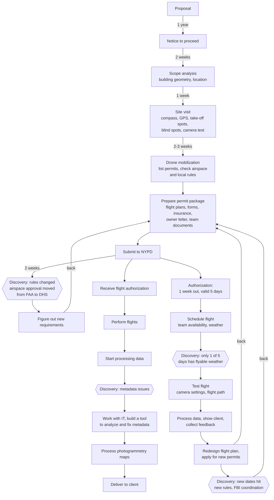
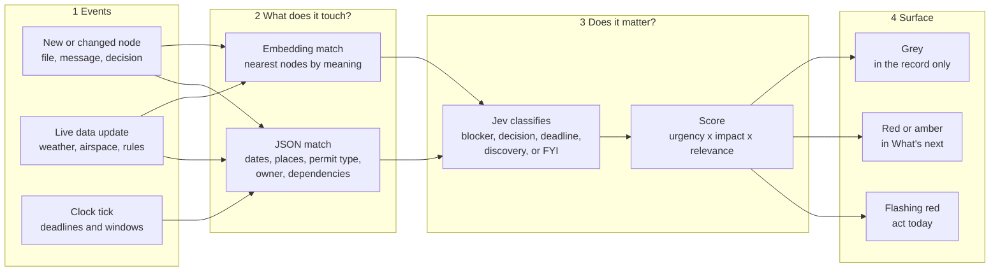

# Worked example: facade survey lifecycle, and how the system surfaces what matters

_Draft for team critique · 2026-11-14 · companion to [plan.md](plan.md)_

This takes the real project our drone experts sketched on the whiteboard and asks two things: what would the system have done at each step, and how does it decide what to put in front of whom, and when.

The lifecycle below is transcribed from a handwritten whiteboard. **Drone experts: please correct anything misread**, especially the durations and the agencies involved.

## 1. The project as it actually went

Task: facade inspection and repair. Method: drone mapping of the facade to inspect it virtually and estimate repair effort.



What stands out:

- **The permit package is the hub.** Three separate loops return to it. Each return is rework triggered by something learned late.
- **Lead times collide.** The NYPD permit needs a date chosen 30 days ahead; weather is only knowable 2 to 3 days ahead. The date is picked blind.
- **Windows are narrow.** Authorization arrived a week out and lasted 5 days; only 1 day was flyable.
- **The discoveries came from outside the project** (a rule change, an event in the city, a data quirk), and each was found late, by a person, by accident.
- **Dependencies on other people are hidden**: legal for insurance, the property owner for a work letter, each team member for documents, other project managers for staff.

## 2. What the system would have surfaced, and when

| Moment on the whiteboard | Type | What the system shows | To whom | How early |
| --- | --- | --- | --- | --- |
| NYPD permit needs a date 30 days ahead | Deadline | "Latest day to submit for a flight in the week of X is Y." Counts down; turns red as Y nears | Pilot, PM | From mobilization, weeks ahead |
| Insurance proof, owner work letter, team documents | Blocker | Checklist of permit package items, each with an owner and status. "Insurance request to legal not sent; typical turnaround N days; package is blocked" | PM | The day the package starts |
| Date chosen blind against weather | Decision | "Pick a permit date": shows historical weather odds for candidate weeks and what else is booked | Pilot | At date selection |
| Airspace approval moved from FAA to DHS | Discovery | New regulation notice arrives, lands close to the "NYPD permit" node. "This may change your permit requirements. Affected: submitted package" | Pilot, PM | The day the notice is published, not 2 weeks after submitting |
| Authorization valid 5 days, 1 week out | Deadline | Validity window drawn on the schedule with forecast per day. "Only Wednesday is flyable. Confirm team today" | Pilot, PM | The moment authorization arrives |
| Team availability, other PMs | Blocker | "Two of three crew are booked Wednesday on another project. Ask their PM?" with a drafted message | PM | Same moment |
| Client feedback forces a flight plan redesign | Decision | "Redesign means a new permit: earliest new flight date is Z. Proceed?" with the cost of the loop stated | PM, client (simplified) | When feedback is logged |
| New dates fall under new rules | Discovery | "The new dates overlap a restriction period. Extra coordination needed" before reapplying | Pilot | When new dates are proposed |
| Metadata issues in captured data | Discovery | Automatic check on upload flags missing or inconsistent metadata right after the test flight, not after the main flights | Pilot | After the first test flight |
| Every loop back to the package | History | Each loop is a revision with its cause. Next project of this kind starts with "last time, these three things caused rework" | Everyone | Next proposal |

## 3. How it works: the attention engine (Proposed)

The idea: **everything that changes is an event, every event is checked against the project graph, and only what scores high for a given person is put in front of them.**



### Step 1. Events

Three sources feed one event stream:

- **Changes in the graph:** a file dropped, a Slack message suggested, a decision recorded, a status changed.
- **Live data:** a new forecast, an airspace restriction, a published rule change, a permit status update.
- **The clock:** a background job that wakes up daily (hourly near a flight) and re-checks every deadline and window, because "nothing happened" is exactly when deadlines get missed.

### Step 2. What does it touch? JSON and embeddings do different jobs

- **JSON (exact):** the event's dates, location, permit type and people are compared with node fields. A forecast for Wednesday touches the flight scheduled Wednesday. A restriction over a map area touches every flight inside it. This also walks dependency links: if the insurance proof is late, everything downstream of the permit package is touched.
- **Embeddings (fuzzy):** the event is embedded and compared with the project's nodes. This is what catches the things nobody wrote a rule for. A notice saying airspace approval moves to a different agency during a major event shares no field with "NYPD take-off permit", but it lands close to it in meaning.
- **Past projects:** the same embedding search over revision histories finds similar situations. "A rule change after submission caused a 2-week loop on the last facade job."

### Step 3. Does it matter? Jev classifies, then a simple score ranks

Jev reads the event plus the nodes it touched and returns a small JSON verdict: the type, a one-line reason, who should care, and what action is suggested. Types, drawn from the whiteboard:

| Type | Meaning | Whiteboard example |
| --- | --- | --- |
| Deadline | Something must be done by a date or a chance is lost | Submit to NYPD 30 days ahead |
| Blocker | Work can't proceed until someone else acts | Waiting on insurance proof from legal |
| Decision | A person has to choose, with trade-offs | Which permit date; redesign or not |
| Discovery | New information that invalidates an assumption | Rule change; 1 flyable day; bad metadata |
| FYI | Relevant, no action | Forecast updated, still fine |

The score is then computed in code, not by the model, so it is explainable and tunable:

- **Urgency = time left ÷ time needed.** Time needed comes from lead times stored on nodes (NYPD permit: 30 days; legal insurance request: N days). An item goes red when time left is close to time needed, and flashes when acting today is the last safe moment. This is what makes a 30-day-out deadline urgent on day 31, not on day 1.
- **Impact = what breaks downstream.** Count and weight of nodes that depend on this one, from the graph. A late owner letter blocks the package, which blocks the permit, which blocks the flight: high. A camera setting note: low.
- **Relevance to this person.** Role (client, PM, pilot), ownership (is it assigned to them), and what they've acted on or dismissed before.
- **Confidence.** How sure the match and classification are. Low-confidence items can be shown, but never as flashing red.

### Step 4. Surface: levels and placement

| Level | Rule of thumb | Where it appears |
| --- | --- | --- |
| Flashing red | Urgent and high impact and confident. Act today or lose the window | Top of "What's next", pulsing node on the canvas, optional Slack ping |
| Red | High impact, days not hours | "What's next", red node |
| Amber | Worth watching; could become red | Amber node, listed lower |
| Grey | Recorded, no action | Only in the graph and the history |

Each role gets a different cut of the same events. For "only 1 of 5 days is flyable":

- **Pilot:** flashing red. "Confirm Wednesday crew and equipment today."
- **PM:** red. "Two crew are double-booked Wednesday. Message their PM?"
- **Client:** a calm status line. "Flight confirmed for Wednesday, the one suitable day in the permit window."

### Keeping it trustworthy

- **A cap on flashing red:** at most one or two per person at a time. If everything flashes, nothing does.
- **Always say why:** every surfaced item shows its one-line reason and the nodes behind it.
- **Snooze, dismiss, "not mine":** each response is saved as a revision and lowers the score of similar items for that person.
- **Merge duplicates:** five forecast updates about the same day become one item that updates in place.
- **Escalate quietly:** an ignored amber item rises as its deadline nears; an ignored red item goes to the PM.

## 4. Messenger nanny: chasing deliverables and dropped balls in Slack (Proposed)

Surfacing inside the app only helps people who are looking at the app. The nanny is an agent that lives in Slack and makes sure owned items actually get done: it pokes, follows up, and escalates when needed.

**What it watches**

- **Deliverables and deadlines:** any open attention item or node with an owner and a due date (permit package items, client deliverables, reviews).
- **Blockers waiting on someone:** "insurance proof from legal", "work letter from the property owner", "team documents".
- **Dropped balls:**
  - Commitments made in chat. Jev reads messages like "I'll send the flight plan tomorrow" and records a commitment with an owner and a date.
  - Questions nobody answered. An unanswered question is matched by embedding to the open item it relates to.
  - Items with no owner, and suggestions nobody approved or dismissed.

**The nudge ladder**

| Step | When | What the nanny does |
| --- | --- | --- |
| 1. Heads-up | Item enters its lead-time window | DM to the owner: what is due, when, and why it matters ("blocks the NYPD submission") |
| 2. Reminder | No response, urgency rising | Second DM that states the consequence and offers help: a drafted reply, the form, the file |
| 3. Public poke | Item is red | Posts in the project channel thread, tagging the owner |
| 4. Escalate | Item is flashing red, or the owner is unresponsive | Tells the PM: what's stuck, who has it, what slips if it isn't done, and options (reassign, extend, drop) |
| 5. Reassign or accept | PM decides | The decision is recorded as a revision; the nanny starts over with the new owner or date |

**How people answer it.** Every message has buttons: **Done**, **Need more time** (pick a date), **Blocked** (say by what), **Not mine**. Each answer updates the graph and is saved in the revision history, so the record shows who was asked, when, and what they said.

**People outside Slack.** For legal, the property owner or the client, the nanny drafts the email or message and asks the PM to send it. It then tracks the reply as a blocker like any other.

**Keeping it tolerable**

- Timing follows the urgency score from section 3, so it starts gentle and only gets loud when time is short.
- One message per person per item per step; several items for one person are bundled into a single digest.
- Quiet hours and "snooze until" are respected, except for flashing red.
- It never escalates without first telling the owner it is about to.
- Tone is helpful, not nagging: every poke includes the reason and something that makes the task easier.

**On the whiteboard project** it would have: chased legal for the insurance proof and the owner for the work letter from the day the package started; reminded each crew member to upload their documents; pinged the other PMs about crew availability the moment the 5-day window arrived; and escalated to the PM when the submit-by date for NYPD was three days out with the package incomplete.

**Build note.** A Slack app using Socket Mode works from a laptop in Docker with no public URL. It needs a Slack bot token in `.env` and a workspace where we're allowed to install an app.

## 5. What this needs from the data model

Additions to the node sketch in [plan.md](plan.md), section 9:

```json
{
  "node": {
    "status": "not_started | waiting | in_progress | done | blocked",
    "owner": "user id or external party, e.g. legal, property owner",
    "due": "2026-12-01",
    "lead_time_days": 30,
    "valid_from": "2026-12-08",
    "valid_to": "2026-12-12",
    "depends_on": ["n_021", "n_022"],
    "phase": "proposal | scope | site_visit | mobilization | permitting | flight | processing | delivery"
  },
  "attention_item": {
    "id": "att_57",
    "event": "ev_903",
    "type": "deadline | blocker | decision | discovery | fyi",
    "touches": ["n_045", "n_031"],
    "matched_by": ["json:date", "embedding:0.83"],
    "reason": "Authorization is valid 8-12 Dec; forecast shows only 10 Dec under the wind limit",
    "suggested_action": "Confirm crew for 10 Dec",
    "scores": {"urgency": 0.95, "impact": 0.8, "confidence": 0.9},
    "for": {"pilot": "flashing_red", "pm": "red", "client": "status_line"},
    "state": "open | snoozed | dismissed | done",
    "nudges": [{"step": 1, "to": "user id", "at": "2026-12-05T09:00Z", "via": "slack_dm", "response": "need_more_time"}]
  },
  "commitment": {
    "id": "com_12",
    "source": "slack permalink",
    "owner": "user id",
    "text": "I'll send the flight plan tomorrow",
    "due": "2026-12-06",
    "relates_to": ["n_045"],
    "state": "open | done | lapsed"
  }
}
```

A **project template** for "facade survey in NYC" would pre-load the lifecycle phases, the permit package checklist and the known lead times, so the countdowns start on day one.

## 6. Suggested demo slice

Replaying this whiteboard project as a timeline is a strong demo: scrub through the weeks and watch the system raise each item before the team in the real project found out.

1. Load the facade survey template; the permit checklist and countdowns appear.
2. Advance time: the "submit to NYPD by" item goes amber, then red.
3. Inject the rule-change notice: it attaches itself to the permit node and flashes for the pilot.
4. Authorization arrives: the 5-day window is drawn with weather; one day is green.
5. The package is incomplete three days before the submit-by date: the nanny DMs the owner in Slack, then escalates to the PM.
6. Switch to the client view: the same events as a calm, plain-language feed.

## 7. Questions this raises

**For the drone experts:**

1. Are the lead times right, and which others exist (insurance, owner letter, community notice)? These numbers drive the urgency score.
2. Where do rule changes actually get published, and how did you find out about this one? That tells us what to monitor.
3. Which of the discoveries would you have most wanted a week earlier?
4. What's a false alarm that would make you stop trusting the system?
5. What does the permit package contain exactly, and which items most often hold it up?
6. When someone drops the ball today, who chases them and how? At what point does it go to their manager?

**For the team:**

1. Is the replay of this project our headline demo?
2. How much of the lifecycle do we template by hand versus letting Jev infer from documents?
3. Do we score in code (as proposed) or let Jev score directly? Code is explainable; Jev is more flexible.
4. How pushy should the nanny be by default, and who can it escalate to? Can it message people in the real hackathon Slack for the demo, or do we need a test workspace?
5. Does the nanny read all channel messages to find commitments, or only channels it's invited to?
