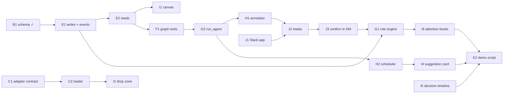

# Build breakdown: drone project decision system

_Draft for team critique · 2026-11-14 · follows Ryan's [use-cases-and-decisions.md](../Ryan/use-cases-and-decisions.md) (demo target and backbone decisions) and [agent-architecture.md](../Ryan/agent-architecture.md), and adds the lineage pieces from [plan.md](plan.md) and [decision-engine.md](decision-engine.md)_

**How to read this:** the demo, tiers and backbone decisions are Ryan's; this file turns them into work items. Each item has an ID you can turn into a ticket. **Priority** maps to Ryan's tiers: **P0** = Must, **P1** = Should, **P2** = Could or later. **Size:** S ≈ under 2 h, M ≈ half a day, L ≈ a day or more for one person. Owners are suggestions; change freely.

## 1. Where we are

| Piece | State | Where |
| --- | --- | --- |
| Brief, system plan, role mockups | Done | `Ryan/` |
| Facade survey worked example, attention engine, messenger nanny | Done (draft) | `Ryan/usecase-facade-survey.md` |
| Agent architecture: analysis loop, node-type rules, packs | Done (draft) | `Ryan/agent-architecture.md` |
| Use cases, demo target, backbone decisions | Done (draft) | `Ryan/use-cases-and-decisions.md` |
| Embedding helper (local EmbeddingGemma 2 by default, Gemini Embedding 2 fallback, 768 dims) | Built | `api/embeddings.py`, `.env.example` |
| Converter: any file to parts with pointers | Built, not merged | `origin/converter` |
| Lineage plan, facade use case, mockups | Done (draft) | `Sharare/plan.md`, `Sharare/docs/` |
| Schema + seed following Ryan's node types, edges, rules, events; checks pass | Built and tested locally | `Sharare/db/`, branch `sharare/decision-engine` |
| API routes, worker, rule engine, specialists, Slack app, MCP server, front end | **Not started** | |

## 2. Decide first (Ryan's list)

Ryan's "decide first" items, with where each stands. Recommendations are Ryan's.

| # | Decision | Ryan's recommendation | Status |
| --- | --- | --- | --- |
| Q1 | **R1 + L1:** every change is an event in one Postgres log, worked by a worker | Yes | The schema implements it (`events`, `agent_tasks`) |
| Q2 | **G2 + G3 + G4:** node types, edge types, candidate status | Fixed core set, fixed edge vocabulary, status on the node | In the schema; open: adding `analysis` and `observation` types (decision-engine.md §9) |
| Q3 | **E1:** embedding model | Gemini Embedding 2 in the doc; the code now defaults to local EmbeddingGemma 2 with Gemini as fallback | Following the code: local default, 768 dims, model id stored per vector |
| Q4 | **E4:** adapter contract with Minh | One shared shape: source, metadata, parts with pointers | Ryan + Minh to agree; the loader (C2) follows whatever they settle |
| Q5 | **A3:** entity registry | Registry of people, equipment, places, permits with aliases | In the schema (`entity` nodes, `entity_aliases`) |
| Q6 | **L6:** Slack workspace | Check the hackathon workspace today, test workspace as fallback | Open |
| Q7 | **L4 + Jev:** Opus-class model route and Jev's model ID | Through OpenRouter on the team key | Open (exact IDs) |
| Q8 | **Front-end stack** (not in Ryan's list) | — | Front-end team's call; plan.md suggested React Flow |

## 3. The demo (Ryan's 3 minutes)

1. **Drop:** a site photo, a permit PDF and a 3D model become typed, tagged, linked nodes.
2. **Slack:** "drone 4a needs maintenance" → Mary confirms in a DM → node appears, Thursday's flight flashes red.
3. **Decide:** the pilot approves "move to Monday" with a reason → a revision with reason and evidence. _The lineage layer shows here: the suggestion card lists the exact inputs it rests on, and the timeline shows the decision's versions._
4. **Switch role:** client view, "Flight moved to Monday: equipment maintenance."
5. **Close the loop:** the analysis loop proposes "when equipment is reported faulty, check permits that name it"; approve on screen.

The seed already holds the facade survey state for this, including the stale forecast on D-014 as a second, replayable trigger.

## 4. Work items

### A. Repo and platform

| ID | Item | Pri | Size | Depends on | Done when |
| --- | --- | --- | --- | --- | --- |
| A1 | Merge `sharare/decision-engine` and `origin/converter` into main; move compose and `db/` to the repo root next to `api/` | P0 | S | | One checkout has api, converter, db and all plans |
| A2 | Root `docker-compose.yml`: db, api, worker, web; code mounted for hot reload; api reaches the local embedding server per `.env.example` | P0 | M | A1 | `docker compose up` gives an empty canvas talking to the API and DB |
| A3 | `.env.example` | P0 | — | | **Done** (Ryan) |
| A4 | `make reset` / `make demo`: clean seeded state in one command | P1 | S | A2, K1 | |
| A5 | README with setup, including `docker-compose` vs `docker compose` on Homebrew Docker | P1 | S | A2 | |

### B. Database

| ID | Item | Pri | Size | Depends on | Done when |
| --- | --- | --- | --- | --- | --- |
| B1 | Schema following R1, G2–G5, A3, E2–E3, L2, L5, plus versions and lineage | P0 | — | | **Done**, `db/init/001_schema.sql` |
| B2 | Decision-version consistency check (version row and decision row written together) | P1 | S | B1 | Writing one without the other fails at commit |
| B3 | Stale propagation through analyses (stale input → stale analysis → stale decision) | P1 | S | B1 | `stale_decisions` includes "stale via A-01" |
| B4 | `lineage_level(version, simple | medium | advanced, as_of)` wrapper | P1 | S | B1 | Three levels return ~5 / ~20 / everything on the seed |
| B5 | Hybrid search SQL: vector (one model) + mentions + type/time filters | P0 | M | B1, C5 | One query used by the `search` tool and the UI |
| B6 | Head-version check for proposals | P1 | S | B1 | Two concurrent proposals can't overwrite each other |
| B7 | Replay: rebuild node working fields from `events` (Ryan R1 "replay demo") | P2 | M | E1 | Scrub the facade project as a timeline |

### C. Ingestion (Ryan's adapters, Minh's converter)

| ID | Item | Pri | Size | Depends on | Done when |
| --- | --- | --- | --- | --- | --- |
| C1 | Adapter contract agreed (E4) and the converter emitting it | P0 | S | Q4 | Ryan and Minh sign off on one shape |
| C2 | **Loader:** adapter output → node + version + chunks (with pointers) + mentions + converter edges | P0 | M | C1, B1 | Dropping a PDF makes one typed node with parts in Postgres |
| C3 | Annotator call on each new node: type, summary, tags, entities, confidence (A1, A2) | P0 | M | C2, G2 | Nodes arrive typed and tagged |
| C4 | Upload endpoint + inbox folder, same pipeline | P0 | S | C2, E1 | Drag-drop and folder drop behave the same |
| C5 | Embedder: parts + one card vector per node via `api/embeddings.py` | P0 | S | C2 | Search finds the uploaded PDF by meaning |
| C6 | New-version matching: same filename or alias in the project → v2 of the node | P1 | M | C2 | Re-uploading the permit package makes DOC-07 v2 |
| C7 | 3D model through the converter's Rhino adapter (Ryan's Should tier) | P1 | S | C2 | The model drop in demo step 1 works |
| C8 | Observations from drone images (plan.md principle 3) | P2 | M | C2 | |

### D. Live data feeds

| ID | Item | Pri | Size | Depends on | Done when |
| --- | --- | --- | --- | --- | --- |
| D1 | Weather feed with change threshold; polling tightens inside 72 h of a flight | P1 | M | C2 | Only meaningful changes create a version |
| D2 | Replay script for the facade story (forecast changes, rule change, permit email) | P0 | S | E1 | The demo plays the same every time |
| D3 | Airspace / regulation feed or replayed notices | P2 | M | C2 | |
| D4 | Crew calendar as a feed (use case 9) | P2 | S | C2 | |

### E. API (FastAPI, in `api/`)

| ID | Item | Pri | Size | Depends on | Done when |
| --- | --- | --- | --- | --- | --- |
| E1 | Write paths, each emitting an event: create node/version, update working fields (before/after), confirm/dismiss candidate, approve/dismiss proposal, review edge, approve rule. All approvals go to one `approvals` record (L5) | P0 | M | B1 | Every change is in the event log |
| E2 | Read paths: canvas graph, node detail + history, decision timeline, proposals, attention by role, stale, awaiting | P0 | M | B1 | The front end renders the seed with no mock data |
| E3 | Live push to the front end (G6) from `LISTEN events` | P0 | S | E1 | The canvas changes by itself when Slack confirms |
| E4 | Roles and user switcher; client view is read-only | P0 | S | E1 | |

### F. Graph tools and MCP

| ID | Item | Pri | Size | Depends on | Done when |
| --- | --- | --- | --- | --- | --- |
| F1 | Graph tools, MCP-shaped (L3): search, resolve_entity, get_node/version, neighbors, lineage, history, list_*, create_candidate, propose_decision, propose_link, propose_rule. Reads record `run_reads` | P0 | M | E2, B5 | One set of functions for specialists and MCP |
| F2 | MCP server (FastMCP) over F1 | P1 | S | F1 | Claude Desktop answers "why did the flight move?" with citations |
| F3 | Per-user MCP tokens mapped to roles | P2 | S | F2 | |

### G. Runtime: rule engine and agent loop

| ID | Item | Pri | Size | Depends on | Done when |
| --- | --- | --- | --- | --- | --- |
| G1 | **Rule engine** (Ryan agent-architecture §7 step 1): evaluates JSON rules on events, cheap conditions in code, optional Jev judgment; writes attention items and triggers specialists | P0 | M | E1 | One rule turns a node red for a real reason (Must tier) |
| G2 | **`run_agent()`** hand-rolled loop (L3) on OpenRouter, logging `runs`/`run_steps` | P0 | M | F1, Q7 | Any specialist run is inspectable step by step |
| G3 | Guards: schema, citations ⊆ `run_reads`, budgets, head-version check | P0 | S | G2 | A made-up citation is rejected |
| G4 | Replay cache for model calls (Ryan's "recorded fallback" risk) | P0 | S | G2 | The rehearsed demo runs offline |
| G5 | Worker: dispatcher over `agent_tasks` with dedupe and chain depth | P0 | S | E1 | One trigger → one specialist run |
| G6 | Lineage conditions for rules: "cited input has a newer version", "all needs resolved" | P1 | S | G1 | `rule_040` fires on the forecast change |
| G7 | Seed the facade survey pack with 5–6 rules (Ryan §7 step 2) | P0 | S | G1 | Rules from the agent-architecture table are active |

### H. Specialists and agents

| ID | Item | Pri | Size | Depends on | Done when |
| --- | --- | --- | --- | --- | --- |
| H1 | **Annotator** with entity resolution and candidate-by-source (A3–A5) | P0 | M | G2, F1 | "drone 4a" resolves to DRONE-4A and becomes a candidate asked of Mary |
| H2 | **Scheduler** specialist: proposes a new flight date as a `proposed` decision version with cited inputs | P0 | M | G2, G3 | "Move to Monday" appears as a suggestion card with its inputs |
| H3 | **What's next** from the revision history (Should tier) | P1 | S | H2 | One Jev call over recent events |
| H4 | **Q&A / client trace** in plain language (use cases 6, 7) | P1 | S | F1, G2 | Client view: "why did the date move?" |
| H5 | **Analysis loop** run once live, proposing one rule with a dry run (Could tier) | P2 | M | G1, G2 | Approve the rule on screen and see it fire in the replay |
| H6 | **Messenger nanny**: DMs owners, escalates to the PM | P2 | M | J1, G1 | |
| H7 | Lineage finder for hand-logged decisions | P2 | M | B5, G2 | |
| H8 | Flight-window analysis (registered script) | P2 | M | D1 | |

### I. Front end

| ID | Item | Pri | Size | Depends on | Done when |
| --- | --- | --- | --- | --- | --- |
| I1 | **Canvas**: typed nodes, links, ghosted candidates, colour by attention level | P0 | L | E2, Q8 | The seed renders as a readable graph |
| I2 | Drop zone | P0 | M | C4 | Drop a file, the node appears live |
| I3 | Node detail with version history | P0 | M | E2 | |
| I4 | **Suggestion card**: statement, reason, cited inputs, approve with reason | P0 | M | E1 | The pilot approves "move to Monday" |
| I5 | **Decision timeline**: revisions with reason and evidence | P0 | M | E2 | The Must-tier decision history is visible |
| I6 | Attention levels: flashing red / red / amber / grey per role | P0 | S | G1 | Thursday's flight flashes red after Mary confirms |
| I7 | Client view (Should tier) | P1 | M | E2, H4 | Plain-language feed, no graph |
| I8 | Lineage view with simple / medium / advanced and an `as_of` slider (plan.md §6) | P1 | L | B4 | |
| I9 | What's next panel | P1 | S | H3 | |
| I10 | Rule approval screen with dry-run results | P2 | M | H5 | |

### J. Slack (Ryan's hero moment)

| ID | Item | Pri | Size | Depends on | Done when |
| --- | --- | --- | --- | --- | --- |
| J1 | Slack app installed in a workspace we control (L6) | P0 | S | Q6 | Bot can read the channel and DM people |
| J2 | Message events → annotator → candidate node | P0 | M | J1, H1 | Alice's message creates B-05 as a candidate |
| J3 | DM to the owner with Add / Not relevant / Already known + a detail field; answer writes the approval (L5) | P0 | M | J2, E1 | Mary taps Add, the node confirms on the canvas |
| J4 | Answer "can we still fly Thursday?" in thread (use case 6) | P2 | M | H4 | |

### K. Demo, data and experts

| ID | Item | Pri | Size | Depends on | Done when |
| --- | --- | --- | --- | --- | --- |
| K1 | Demo seed: extend `002_seed.sql` to the full facade story (Drone 4A on Thursday's flight and in the permit, Monday option, believable history) | P0 | M | | Opening the app shows a project with a past |
| K2 | Demo script and two rehearsals | P0 | S | | |
| K3 | An hour with the drone experts for believable numbers (Ryan's risk) | P1 | — | | Lead times and limits are real |
| K4 | Recorded fallback of the full demo | P1 | S | K2 | |
| K5 | Dogfood use case 13 on our own Slack and transcripts | P2 | M | J2 | |

## 5. Suggested owners and parallel tracks

| Track | Workstreams | Suggested lead | Can start now? |
| --- | --- | --- | --- |
| Platform + DB + API | A, B, E | Sharare | Yes; schema is done |
| Ingestion + feeds | C, D | Minh, with Ryan on the adapter contract | Yes, once E4 is agreed |
| Runtime, agents, MCP | F, G, H | Ryan | G1 and G5 yes; G2 needs model IDs |
| Slack | J | Ryan or whoever owns the Slack app | J1 today (workspace check) |
| Front end | I | Front-end team | Yes, against the seed |
| Demo + experts | K | Pitch owner | Yes |

## 6. Critical path

**Minimum demo (all P0, Ryan's Must tier):** drop → typed nodes on the canvas; Slack message → Mary confirms → Thursday's flight flashes red; pilot approves the move with a reason → decision timeline shows the revision and its evidence.

**Cut first if time runs short:** the analysis loop live run, the nanny, the lineage slider, MCP, real feeds (replay instead).

## 7. Risks (Ryan's, plus two)

| Risk | Mitigation |
| --- | --- |
| Slack app can't be installed in the hackathon workspace | Check today (J1); test workspace as fallback |
| Live model calls lag | Replay cache (G4) and a recorded fallback (K4) |
| Seed data isn't believable | An hour with the drone experts (K3) |
| The local embedding server is on one laptop on the venue Wi-Fi | `api/embeddings.py` already falls back to Gemini; keep one model per index |
| Adapter output and the loader drift apart | Agree E4 first (C1); the loader is the only consumer |
