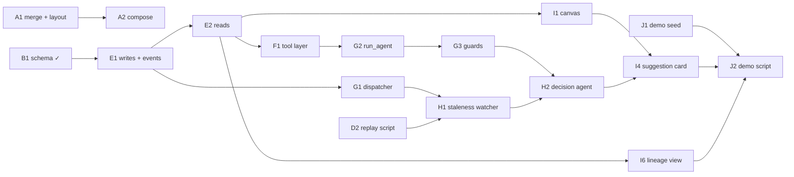

# Build breakdown: drone project decision system

_Draft for team critique · 2026-11-14 · pulls together [Ryan's plan](../Ryan/plan.md), [plan.md](plan.md), [decision-engine.md](decision-engine.md), the [facade use case](docs/use-case/facade-inspection.md) and the converter branch (`origin/converter`)_

**How to read this:** items are grouped by workstream, each with an ID you can turn into a ticket. **Priority:** **P0** = the demo doesn't work without it, **P1** = makes the demo convincing, **P2** = stretch. **Size:** S ≈ under 2 h, M ≈ half a day, L ≈ a day or more for one person. Owners are suggestions based on who wrote what so far; change freely.

## 1. Where we are

| Piece | State | Where |
| --- | --- | --- |
| Project brief, system plan, three role mockups | Done | `Ryan/` on main |
| Back-end plan: capture, versions, lineage, temperature, analyses | Done (draft) | `Sharare/plan.md` (**not committed yet**) |
| Facade use case + canvas/lineage/sources mockups | Done | `Sharare/docs/` (**not committed yet**) |
| Converter: any file → package with chunks, assets, entities, links | Built, not merged | `origin/converter` |
| Decision engine design: graph, agents, MCP | Done (draft) | `Sharare/decision-engine.md` |
| Postgres + pgvector schema, seed, compose; stale view, lineage and append-only checks pass | Built and tested locally | `Sharare/db/`, `Sharare/docker-compose.yml` |
| API, worker, agents, MCP server, front end | **Not started** | |

## 2. Decisions to make first (blocking, Q1–Q7)

| # | Decision | Recommendation | Blocks |
| --- | --- | --- | --- |
| Q1 | **Demo story** | The facade **permit / weather / team scheduling loop**. Both plans already converge on it, the seed data tells it, and it shows stale decisions, awaits and agent suggestions in one flow | Seed data, agent prompts, front-end copy |
| Q2 | **Jev's model ID on OpenRouter**, and a cheap model for bulk work | Pick both now; the loop can start on any OpenAI-compatible model and swap later | G2, H2–H7 |
| Q3 | **Embedding model** | `gemini-embedding-2` at 768 dimensions (confirm truncation), local EmbeddingGemma as the offline story | C5, H3 |
| Q4 | **Linear history or branches** | Linear for the demo; the `branch` column is already there for later | Lineage UI scope |
| Q5 | **Front-end stack** | React + React Flow for the canvas and the lineage graph (elkjs for layout) | All of I |
| Q6 | **Repo layout** | One monorepo: `converter/`, `api/`, `worker/`, `web/`, `db/`, `docs/`, compose at the root | A1 |
| Q7 | **Owners per workstream** | See section 4 | Everything |

## 3. Work items

### A. Repo and platform

| ID | Item | Pri | Size | Depends on | Done when |
| --- | --- | --- | --- | --- | --- |
| A1 | Commit `Sharare/`, merge `origin/converter`, move to the monorepo layout (Q6) | P0 | S | Q6 | main has converter, db, plans; nothing lives only on a laptop |
| A2 | Root `docker-compose.yml`: db, api, worker, web (collab and runner later); code mounted for hot reload | P0 | M | A1 | `docker compose up` gives an empty canvas talking to the API and DB |
| A3 | `.env.example` (OpenRouter key, model IDs, `EMBEDDING_PROVIDER`, MCP tokens); `.env` stays ignored | P0 | S | A1 | New teammate is running in under 10 minutes |
| A4 | `make reset` = `down -v && up` + seed; `make demo` loads the demo seed | P1 | S | A2, J1 | One command gets back to a clean demo state |
| A5 | README with setup, including the `docker-compose` vs `docker compose` note for Homebrew Docker | P1 | S | A2 | |

### B. Database

| ID | Item | Pri | Size | Depends on | Done when |
| --- | --- | --- | --- | --- | --- |
| B1 | Schema (nodes, versions, decisions, inputs, awaits, chunks, entities, edges, runs, queue, events) | P0 | — | | **Done**, `db/init/001_schema.sql` |
| B2 | Consistency check: a decision-family version must have its `decision_versions` row (deferred constraint trigger) | P1 | S | B1 | Writing one without the other fails at commit |
| B3 | Stale propagation through analyses: an analysis output is stale if a run input has a newer version, and so is any decision citing it | P1 | S | B1 | `stale_decisions` includes "stale via A-01" |
| B4 | `lineage_level(version, 'simple' | 'medium' | 'advanced', as_of)` wrapper with top-k and temperature filters (plan.md §6) | P0 | S | B1 | Three levels return ~5 / ~20 / everything on the seed |
| B5 | Hybrid search SQL: vector + entity match + kind/time filters, `as_of` aware | P0 | M | B1, C5 | One query used by the `search` tool and the UI |
| B6 | Head-version check helper for proposals (reject if the decision moved on) | P1 | S | B1 | Concurrent proposals can't overwrite each other |

### C. Ingestion (file → node)

| ID | Item | Pri | Size | Depends on | Done when |
| --- | --- | --- | --- | --- | --- |
| C1 | Converter as a library inside the worker (`convert_file` already exists) | P0 | S | A1 | Worker imports it; no separate server needed |
| C2 | **Loader:** package → node + version (metadata, raw_uri, hash) + chunks + entities + converter links as edges | P0 | M | C1, B1 | Dropping a PDF makes one node with chunks and entities in Postgres |
| C3 | New-version matching: same filename/alias + kind in the project → v2 of the node (UI can override); emails thread on Message-ID | P1 | M | C2 | Re-uploading an edited permit package makes DOC-07 v2, which makes D-011 stale |
| C4 | Inbox watcher on `./data/inbox` + upload endpoint, both calling the same pipeline | P0 | S | C2, E1 | Drag-drop and dropping into the folder behave the same |
| C5 | Embedder job: embeds chunks lazily, stores `embedding_model`; OpenRouter or local behind one function | P0 | M | Q3, C2 | Search returns the uploaded PDF by meaning |
| C6 | Observations from drone images: a cheap vision model writes short findings as observation nodes (plan.md principle 3) | P1 | M | C2, Q2 | A flight folder produces observation nodes, not raw images in search |
| C7 | Capture instructions compiled to a spec, with a preview and approval (plan.md §7), for the weather source only | P2 | M | Q1 | "Only gusts, rain, visibility 07:00–17:00" filters the weather capture |

### D. Live sources

| ID | Item | Pri | Size | Depends on | Done when |
| --- | --- | --- | --- | --- | --- |
| D1 | Weather connector (NWS hourly) with hash + change threshold → new version only on a meaningful change | P0 | M | C2 | A forecast change creates W-01 v2; an unchanged poll creates nothing |
| D2 | **Replay script:** timed feed of forecast versions, an email, a rule change, so the demo is the same every time | P0 | S | D1 | `make demo` plays the story on cue |
| D3 | Airspace / TFR connector (FAA) or a replayed regulation source | P1 | M | C2 | The FAA → DHS change arrives as R-01 v2 |
| D4 | Team calendar / availability source (seeded or a simple file) | P1 | S | C2 | "Dev K. booked from 23 Nov" is a node |
| D5 | Slack or Teams via an external MCP server, as a source connector with "suggested, not auto-placed" items | P2 | L | F2 | A Slack message shows up as a floating suggestion |

### E. API (FastAPI)

| ID | Item | Pri | Size | Depends on | Done when |
| --- | --- | --- | --- | --- | --- |
| E1 | Write paths: create node/version, log a decision, edit (new version), accept/dismiss a suggestion with the inputs the reviewer kept, review an edge. Each write also writes an event in the same transaction | P0 | M | B1 | All writes go through the API; the events table fills |
| E2 | Read paths: project graph for the canvas, node detail + history, lineage by level, stale, awaiting, proposed suggestions, activity feed | P0 | M | B4 | Front end can render the seed with no mock data |
| E3 | WebSocket broadcast from `LISTEN events` | P0 | S | E1 | Accepting in one browser updates the other |
| E4 | Roles: view level + `can_review` per project; seeded users and a user switcher (no real login) | P0 | S | E1 | The client can't accept; Mara can |
| E5 | Comments on nodes | P2 | S | E1 | |

### F. Tool layer and MCP

| ID | Item | Pri | Size | Depends on | Done when |
| --- | --- | --- | --- | --- | --- |
| F1 | **Tool layer:** `search`, `get_version`, `get_node`, `neighbors`, `lineage`, `history`, `list_stale`, `list_awaiting`, `list_proposed`, `propose_suggestion`, `propose_link`, `request_refresh`, `run_analysis`. Pydantic signatures; every read records `run_reads` | P0 | M | E2, B5 | The same functions serve the agents and MCP |
| F2 | **MCP server** (FastMCP, streamable HTTP at `/mcp`) exposing F1 plus resources `project://`, `node://`, `decision://…/lineage` and prompts `explain_decision`, `whats_next` | P1 | S | F1 | Claude Desktop answers "why did we move the north facade flight?" with version citations |
| F3 | Per-user MCP tokens mapped to roles; MCP writes are `origin = mcp`, proposed only | P1 | S | F2, E4 | A client-role token can only read |

### G. Agent runtime

| ID | Item | Pri | Size | Depends on | Done when |
| --- | --- | --- | --- | --- | --- |
| G1 | **Dispatcher:** `LISTEN events` → event-to-agent map → `agent_tasks` with `dedupe_key = decision:<id>` and chain depth ≤ 3; workers claim with `SKIP LOCKED` | P0 | M | E1 | One forecast change queues exactly one re-check of D-014 |
| G2 | **`run_agent(spec, task)`:** context pack → OpenRouter chat with tools → tool execution → loop until final JSON or budget; logs `runs` and `run_steps` | P0 | M | F1, Q2 | A run is fully inspectable step by step |
| G3 | Guards: output schema validation, citations ⊆ `run_reads` with one retry, step/time/token budgets, head-version check (B6) | P0 | S | G2 | A made-up citation is rejected and nothing is written |
| G4 | **Replay cache** keyed by hash(model, messages, tools); a demo mode that never calls the network | P0 | S | G2 | The rehearsed demo runs offline and identically |
| G5 | Autonomy table in project settings (auto / propose / human only per action) | P1 | S | G2 | Tags auto-apply; suggestions wait for review |
| G6 | Sub-runs: the decision agent can call another agent or analysis as a tool, logged under the parent run | P2 | M | G2 | One run shows "called flight_window" inside it |

### H. Agents

| ID | Item | Pri | Size | Depends on | Done when |
| --- | --- | --- | --- | --- | --- |
| H1 | **Staleness watcher** (no LLM): on a new version, find decisions and analyses citing an older one; resolve awaits whose source got a matching version | P0 | S | G1, B3 | W-01 v2 → `decision.stale` event for D-014 + a queued re-check |
| H2 | **Decision agent** (Jev): given a decision and its stale input, drafts a suggestion with cited inputs + temperatures + rationale | P0 | M | G2, G3 | S-021 "move to Fri 20 Nov" is produced live, not seeded |
| H3 | **Linker:** vector neighbours + shared entities + time overlap → candidates; cheap model writes type + reason for the top 5 | P1 | M | C5, G2 | An uploaded permit page gets a proposed `constrains` edge to R-01 |
| H4 | **Tagger:** summary + tags + importance for each new evidence version (cheap model) | P1 | S | G2 | Nodes have tags and colour without anyone setting them |
| H5 | **Next-step advisor:** reads recent decision history → "What's next" suggestions (consequences, patterns, gaps) | P1 | M | H2 | After accepting S-021: "notify the client, as last time a flight moved" |
| H6 | **Lineage finder:** for a manually logged decision, ranks inputs captured before `decided_at` | P1 | M | B5, G2 | Logging "submit new permit request" proposes its inputs |
| H7 | **Q&A:** answers with citations, used by the client view and MCP | P1 | S | F1, G2 | The client asks "why did the date change?" and gets a sourced answer |
| H8 | **Flight-window analysis** (registered script): forecast + authorization + limits → viable windows; run recorded with input versions | P1 | M | B1, D1 | A-01 is recomputed when W-01 changes and shows "only 1 of 5 days" |

### I. Front end

| ID | Item | Pri | Size | Depends on | Done when |
| --- | --- | --- | --- | --- | --- |
| I1 | **Canvas:** React Flow graph of nodes + edges, coloured by importance, floating nodes for unplaced items | P0 | L | E2, Q5 | The seed renders as a readable graph |
| I2 | Drop zone + Ctrl+V paste + context fields (from, role, channel, note), reusing the converter UI ideas | P0 | M | C4 | Drop a file, see the node appear live |
| I3 | Node detail panel: content, version history with diff, tags, edges | P0 | M | E2 | Clicking W-01 shows v1 → v2 |
| I4 | **Suggestion card:** statement, rationale, cited inputs with temperatures and checkboxes, accept/dismiss with a required reason | P0 | M | E1 | Mara accepts S-021 keeping 3 of 4 inputs |
| I5 | **Stale and awaiting badges** on decision nodes, with "because W-01 v2" on hover | P0 | S | E2 | D-014 visibly turns stale when the replay fires |
| I6 | **Lineage view:** simple / medium / advanced + `as_of` timeline slider (plan.md §6) | P0 | L | B4 | Step D-014 from v1 to v2 to stale and see which input changed |
| I7 | "What's next" panel | P1 | S | H5 | |
| I8 | **Role views:** client (read-only, "why things changed" feed + Q&A), PM (timeline + schedule strip), pilot (full canvas) per Ryan's mockups | P1 | L | I1, I6, H7 | The same project in three browsers looks right for each role |
| I9 | Activity feed from events | P1 | S | E3 | |
| I10 | Live multi-user canvas with Yjs (positions, cursors, presence) | P2 | L | I1 | Two cursors on one canvas |
| I11 | Agent badge on watched decisions: "watching 4 inputs, 1 pending" | P2 | S | H1 | |

### J. Demo, data and expert input

| ID | Item | Pri | Size | Depends on | Done when |
| --- | --- | --- | --- | --- | --- |
| J1 | **Demo seed** extending `002_seed.sql`: permit loop, 5-day authorization, team calendar, 2–3 flights, client feedback, plus a believable decision history (both plans ask for this) | P0 | M | Q1 | Opening the app shows a project with a past, not an empty canvas |
| J2 | **Demo script** (3 minutes): drop a file → node; forecast refresh → D-014 stale → agent suggests → reviewer accepts → lineage timeline → client view asks why → Claude Desktop over MCP | P0 | S | Q1 | Written, timed, rehearsed twice |
| J3 | Answers from the drone experts: go/no-go limits, which permit documents each regulation change affects, a sanitized real permit timeline (use case open questions) | P1 | — | | Seed numbers are real, not invented |
| J4 | Backup screen recording of the full demo | P1 | S | J2 | |
| J5 | Second and third example project cards (monitoring, manufacturing) as seeds | P2 | M | J1 | |

## 4. Suggested owners and parallel tracks

| Track | Workstreams | Suggested lead | Can start now? |
| --- | --- | --- | --- |
| Platform + DB + API | A, B, E | Sharare | Yes; schema is done |
| Ingestion + sources | C, D | Minh (wrote the converter) | Yes; C1–C2 only need the schema |
| Agents + models + MCP | F, G, H | Ryan (Jev, embeddings, local model) | G1, H1 yes; G2 needs Q2 |
| Front end | I | Front-end team | Yes, against the seed through E2 (or a JSON dump of it until E2 exists) |
| Demo + experts | J | Whoever owns the pitch, with the drone experts | J1, J3 yes |

## 5. Critical path to a working demo

**Minimum demo (all P0):** seeded project on the canvas → replay fires a forecast change → D-014 shows stale → the decision agent proposes the Friday move with cited inputs → the reviewer accepts in another browser → the lineage view steps through the versions. Upload-to-node (C2, C4, I2) runs alongside and joins at the start of the demo.

**Cut first if time runs short:** I10 Yjs (two browsers with a WebSocket refresh are enough), C7 capture specs, D5 Slack, G6 sub-runs, I8 down to client + pilot only.

## 6. Risks

| Risk | Mitigation |
| --- | --- |
| Live model calls are slow or vary during the demo | G4 replay cache; rehearse once online, present offline |
| The embedding choice changes late and forces re-embedding | Decide Q3 on day 1; `embedding_model` column makes a mixed table detectable |
| Front end blocked on the API | Export the seed as JSON today; build I1/I6 against it |
| Converter output doesn't match the schema | C2 is the only adapter; schema already has slots for chunks, entities and converter edges |
| Too much scope (canvas + decision record + agents, Ryan's open question 5) | The P0 line above is the scope; everything else is earned |
