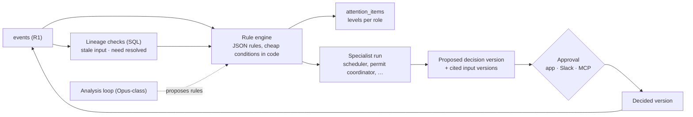

# Decision engine: lineage layer, database, agents and MCP

_Draft for team critique · 2026-11-14 · builds on Ryan's [use-cases-and-decisions.md](../Ryan/use-cases-and-decisions.md), [agent-architecture.md](../Ryan/agent-architecture.md) and [usecase-facade-survey.md](../Ryan/usecase-facade-survey.md), and goes deeper on [plan.md](plan.md) §4–6_

**How to use this doc:** same convention as both plans: **Decided**, **Proposed** or **Open**. Ryan's backbone decisions (R, G, E, A, L numbers) are taken as the direction; this doc shows how the lineage layer from plan.md fits under them. Runnable pieces: [db/init/001_schema.sql](db/init/001_schema.sql), [db/init/002_seed.sql](db/init/002_seed.sql), [docker-compose.yml](docker-compose.yml). Work items and owners: [build-breakdown.md](build-breakdown.md).

## 1. The one-paragraph version

Ryan's backbone: every change is an event in one Postgres log (R1), nodes have fixed types with states (G2), JSON rules evaluated by a fast engine decide what matters (L2), specialists and the annotator act on them, and an Opus-class analysis loop proposes new rules. This doc adds the **lineage layer** on top: every change to a node's content is a **version**, and every decision version points to the **exact input versions** it rested on, each with a temperature. That makes three things cheap: a **stale** check (a decision cites a version that's no longer current), a **lineage** walk at three levels of detail, and a **citation guard** on agents. The same graph tools serve the specialists in-process and outside clients through an **MCP server**.

## 2. Principles (Proposed)

1. **What a decision rests on is a node version.** Specialists use connectors as in Ryan's architecture. When something a connector returned ends up cited by a decision or proposal, it's written back as a node version (Ryan: "results come back as nodes"), so lineage is complete and the demo can replay.
2. **One append-only log (R1), with versions for content.** `events` is the log every change goes through. `node_versions`, `decision_versions`, `decision_inputs` and `approvals` are append-only too (enforced by triggers). A node's working fields (state, owner, due) are current values whose every change is an event with before/after, so the graph can be replayed.
3. **People approve (Ryan §6 guardrails).** Agent and MCP writes create candidates or proposals. One approval record covers the app, Slack and MCP (L5).
4. **Cited means retrieved.** A specialist can only cite a version its run actually read through a tool (§6.4).
5. **Cheap conditions in code, judgment in Jev** (Ryan §3). Stale checks, need resolution, entity and vector matches are queries; the model only ranks, explains or drafts.

## 3. Nodes, versions and decisions (Proposed)

### 3.1 Node types: Ryan's core set (G2)

| Type | States | Lineage role |
| --- | --- | --- |
| decision | awaiting_inputs → ready → decided → superseded | Has versions with cited inputs and needs (§3.2) |
| discovery | new → triaged → absorbed / dismissed | Usually the newer version that makes a decision stale |
| event | scheduled → imminent → happened / missed | Authorization windows, flights |
| data_feed | healthy, changed, stale, failed | New version only on a meaningful change (plan.md §3 thresholds) |
| deliverable | not_started → in_progress → in_review → delivered | Permit package; its versions are what got submitted |
| blocker | open → waiting → done | Slack intake candidates land here |
| constraint | active, changed, expired | Wind limits, airspace rules |
| document | placed, floating | Adapter output; passive evidence |
| entity | active, retired | Shared registry across projects (G5, A3): drones, people, sites |
| **analysis** (proposed addition) | current, stale, failed | Output of a registered script; its run lists input versions (plan.md §8) |
| **observation** (proposed addition) | new, confirmed, dismissed | Short findings from drone imagery (plan.md principle 3) |

Allowed states live in `node_types.states` and a trigger rejects anything else. Candidate status (`candidate | confirmed | dismissed`, G4) is a separate column, so a candidate can already be linked and shown ghosted.

### 3.2 What a decision version holds

A **suggestion is a `proposed` version of the decision itself**, not a separate node type. Approving it writes the next version as `decided`; dismissing it keeps it with the reason. That keeps Ryan's type list intact and gives "the scheduler proposed v3, Dev approved it as v4" in one history.

```
decision_versions  status       awaiting_inputs | ready | proposed | decided | dismissed | superseded | revoked
                   change_kind  created | inputs_changed | proposed | approved | dismissed | edited | superseded | revoked
                   statement, rationale (R4: required once decided; Jev may draft)
                   origin       manual | agent | mcp | slack
                   rule_id      the rule that triggered it (R5)    approval_id  the approval record (L5)
decision_inputs    decision version → input node version, temperature 0..1, influence_reason, suggested_by
decision_needs     decision version → node it is waiting on, expected_by, resolved_by_version   (Ryan's `needs: [...]`)
```

- **Needs drive readiness** (Ryan §2): while a need is unresolved the decision stays `awaiting_inputs` and the input is chased; when the last need resolves, it becomes `ready` and is surfaced with its evidence.
- **Bitemporal-lite:** `valid_at` (true in the world) and `recorded_at` (stored), so a decision logged after the fact only cites inputs that existed when it was made.
- **Accepting copies, it doesn't mutate:** the approved version carries only the inputs the reviewer kept.
- **Scenarios, not branches** (R3): `node_versions.scenario` defaults to `main`; "what if Monday" is a scenario label.

### 3.3 Views the rest of the system reads

| View | Meaning |
| --- | --- |
| `decision_current` | Latest version of each decision that isn't a pending or dismissed proposal |
| `decision_proposals` | Proposed versions newer than the current one (the suggestion cards) |
| `stale_decisions` | Current decisions citing a version that now has a newer one |
| `decisions_awaiting_inputs` | Unresolved needs |
| `lineage(version, depth, min_temp)` | Walk back through cited inputs and analysis-run inputs |

### 3.4 How it lines up with what already exists

| Thing | Becomes |
| --- | --- |
| Ryan's node (§9 + facade survey §5 fields) | `nodes`: type, state, status, owner, due, lead_time_days, valid_from/to, phase, tags, data |
| Ryan's revision / R1 event | `events` (every change); decisions also get a `decision_versions` row with reason and evidence |
| Ryan's edge vocabulary (G3) | `edges.type` check: depends_on, blocks, evidence_for, about, supersedes, derived_from, similar_to (+ part_of, contains, marks_up from the converter) |
| Ryan's attention item, nudge, commitment | `attention_items`, `nudges`, `commitments` tables as sketched in the facade survey |
| Ryan's rule JSON (agent-architecture §3) | `rules` table with the same fields |
| Adapter contract (E4, Ryan + Minh) | One `node_versions` row per file; each part is a `chunks` row with its pointer; one extra `card` chunk per node (E2) |
| `api/embeddings.py` | Fills `chunks.embedding` (768 dims) and stores `model_id()` in `chunks.embedding_model` |

## 4. Database (G1, E3, L1 are Ryan's recommendations; schema Proposed)

Full DDL: [db/init/001_schema.sql](db/init/001_schema.sql). Main tables: `nodes`, `node_types`, `entity_aliases`, `node_versions`, `chunks`, `mentions`, `decision_versions`, `decision_inputs`, `decision_needs`, `edges`, `rules`, `approvals`, `attention_items`, `nudges`, `commitments`, `events`, `agent_tasks`, `runs`, `run_steps`, `run_reads`, plus `sources`, `readings`, `analysis_defs` from plan.md.

- **Postgres + pgvector** in one database, HNSW index on chunk vectors. Search filters on `embedding_model`, as `api/embeddings.py` asks.
- **The queue is a table** (L1): `agent_tasks` claimed with `FOR UPDATE SKIP LOCKED`, woken by `LISTEN/NOTIFY` on `events`. `dedupe_key = decision:<id>` stops two triggers from producing two competing proposals.
- **Agents are users** (`users.kind = agent`), so the log always names a real actor (R5).

**Setup:** `docker-compose up -d db` in this folder (with Homebrew Docker the command is `docker-compose`, with a hyphen). The seed is the facade survey: forecast v2 makes D-014 stale and the scheduler's proposal to move to Friday is waiting; the DHS rule change makes D-011 stale; Alice's "drone 4a needs maintenance" is a candidate blocker resolved to the shared Drone 4A entity, waiting for Mary. Reset with `docker-compose down -v`.

## 5. How decisions get made in Ryan's two-speed architecture (Proposed)

Ryan's runtime (Jev + rule engine) handles every event; the analysis loop proposes rules. The lineage layer adds a few built-in checks and gives specialists versioned inputs to cite.



| Piece (Ryan's name) | What the lineage layer gives it |
| --- | --- |
| **Annotator** (A1–A6) | Writes the version, `mentions` resolved against `entity_aliases`, candidate status by source (A4) |
| **Rule engine** (L2) | Two built-in conditions it can use in `when`: `any cited input has a newer version` and `all needs resolved`. Seed rule `rule_040` uses the first |
| **Specialists** (scheduler, permit coordinator, data QA, client liaison) | Read through the graph tools, write a `proposed` decision version with cited inputs and temperatures |
| **Messenger nanny** | Reads `attention_items` and `commitments`; nudges are logged in `nudges` |
| **Lineage finder** (plan.md §6) | For a decision logged by hand, ranks inputs captured before `decided_at` |
| **Analysis loop** | Reads `events`, `approvals` and rule `stats` to see which rules were ignored; its proposals are `rules` rows with status `proposed` → `dry_run` → `active` |

**Re-entrancy guard:** an agent's own writes don't re-trigger it, and `events.chain_depth` stops agent chains at 3.

## 6. The agent loop (L3: hand-rolled, MCP-shaped tools)

### 6.1 One loop for every specialist

Following L3, a hand-rolled tool-calling loop of about 150 lines. A specialist is a spec: system prompt, allowed tools and connectors, model, output schema, step and token budget, and which node types it may write (Ryan §6). The analysis loop runs on the same loop with an Opus-class model (L4) and a larger budget.

```mermaid
sequenceDiagram
    participant Q as agent_tasks
    participant L as run_agent()
    participant M as Model (OpenRouter)
    participant T as Graph tools + connectors
    participant DB as Postgres
    Q->>L: claim task (SKIP LOCKED)
    L->>DB: insert runs row, build context pack
    loop until final answer or budget
        L->>M: messages + tool schemas
        M-->>L: tool_calls or final JSON
        L->>T: execute tools
        T->>DB: query; connector results that matter become versions
        T-->>L: results (+ run_reads for every version returned)
        L->>DB: run_steps row
    end
    L->>L: validate schema + citations ⊆ run_reads
    L->>T: propose_decision(...)
    T->>DB: node_version + decision_version(proposed) + decision_inputs + event
```

### 6.2 Context pack

The triggering event and rule, the node's current version and 1-hop neighbours (titles and summaries), project limits from `projects.settings`, and the reviewer's role.

### 6.3 Graph tools (shared with MCP, §7)

| Tool | Kind |
| --- | --- |
| `search(query, types?, entities?, as_of?, k)` | read: vector + mention + filters, within one embedding model |
| `resolve_entity(text)` | read: alias lookup, then embedding match (A3) |
| `get_version(id)`, `get_node(id, as_of?)`, `neighbors(node, types?)` | read |
| `lineage(decision_version, level, as_of?)`, `history(node)` | read |
| `list_stale()`, `list_awaiting()`, `list_proposals()`, `list_attention(role)` | read |
| `create_candidate(type, title, source, ask)` | write: candidate status, asks the owner (A5) |
| `propose_decision(decision, statement, rationale, inputs[], needs?)` | write: always `proposed` |
| `propose_link(from, to, type, confidence, reason)` | write |
| `propose_rule(rule_json, evidence)` | write: analysis loop only |
| `run_analysis(def, inputs)` | write, gated: registered analyses only |

### 6.4 Guards

- **Citation check:** every cited version must be in `run_reads` for the run; otherwise one retry, then the run fails and nothing is written.
- **Schema check** on the final output; **budgets** on steps, time and tokens.
- **Replay cache** keyed by hash(model, messages, tools), so the demo runs the same way offline (Ryan's "keep a recorded fallback" risk).

## 7. MCP (Proposed)

### 7.1 Exposing the project graph

The §6.3 tools are plain Python functions with pydantic signatures, MCP-shaped as L3 asks. FastMCP serves the same functions at `/mcp`, so Claude Desktop or Claude Code can ask "why did the north facade flight move, and is it still good?" and get version citations. Per-user tokens map to roles; MCP writes are `origin = mcp` and go through the same approval record.

### 7.2 Using connectors (Ryan §4 packs)

Specialists use the pack's MCP connectors (Slack, email, weather, FAA, maps, calendar) as Ryan describes. For lineage, a connector call that returns something a proposal may cite records it: a data feed gets a new version if it changed beyond its threshold, a Slack message becomes a candidate or version with its permalink. The worker also polls feeds on their own cadence (plan.md §3), tightening inside 72 hours of a flight (Ryan's data-feed rule).

## 8. Build order for this layer

Matches Ryan's "decide first" list: R1 + L1 (event log), G2–G4 (types and candidates), E1 + E4 (embeddings, adapter contract), A3 (entity registry), L6 (Slack workspace).

| Step | Outcome |
| --- | --- |
| 1 | Schema + seed running locally (done; checks pass) |
| 2 | API write paths that emit events; graph tool read functions |
| 3 | Loader from the agreed adapter contract to versions, chunks, mentions, edges |
| 4 | Rule engine with the two lineage conditions; attention items |
| 5 | `run_agent()` with citation guard; scheduler specialist proposing D-014 v3 live |
| 6 | MCP server over the read tools |

## 9. Open questions (for Ryan and the team)

1. **Node types:** OK to add `analysis` and `observation` to the core set, or should they be documents with a tag?
2. **Suggestions as proposed versions** of a decision (§3.2): does that fit how you see suggestions in the attention engine?
3. **Rule conditions:** are "cited input has a newer version" and "all needs resolved" good built-ins for the condition language (L2)?
4. **Needs vs `depends_on` edges:** keep both (needs carry an expected-by date and a condition), or derive needs from edges?
5. **Scenario label:** on versions only, or on events too (the schema has both)?
