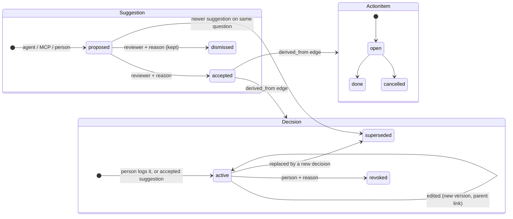
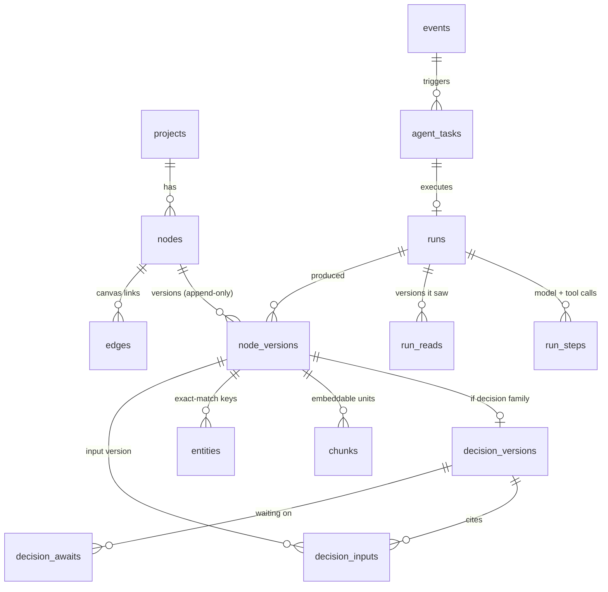
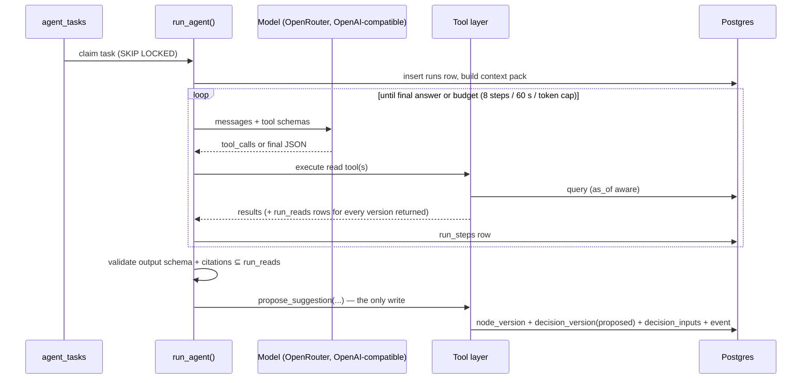

# Decision engine: graph, database, agents and MCP

_Draft for team critique · 2026-11-14 · goes one level deeper than [plan.md](plan.md) §4–6 and [Ryan's plan](../Ryan/plan.md) §3–4, §9_

**How to use this doc:** same convention as both plans: **Decided**, **Proposed** or **Open** on each section. Runnable pieces: [db/init/001_schema.sql](db/init/001_schema.sql), [db/init/002_seed.sql](db/init/002_seed.sql), [docker-compose.yml](docker-compose.yml). Work items and owners: [build-breakdown.md](build-breakdown.md).

## 1. The one-paragraph version

Everything is a **node**, and every change to a node is a new **version** (append-only). A decision is a node whose versions carry a status and point to the **exact input versions** it rested on. That set of version-to-version pointers *is* the decision graph: lineage is a walk over it, and "stale" is one join. Agents are event-driven workers that read the graph through one tool layer and can only **propose**; people accept or dismiss, and that response is itself a new version. The same tool layer is exposed as an **MCP server**, so Claude Desktop, Claude Code or any MCP client can ask "why did we move Thursday's flight?" against the live project. Postgres + pgvector holds all of it, including the job queue.

## 2. Principles (Proposed, extending plan.md §2)

1. **If an agent used it, it's a node version.** Agents don't reason over live API responses or external MCP calls directly. Live data enters as a source → version first, then agents read it. This is what makes lineage complete.
2. **Decision truth is append-only; UI state isn't.** `node_versions`, `decision_versions` and `decision_inputs` reject UPDATE and DELETE (enforced by a trigger). Node position, importance override and edge approval status are ordinary mutable fields, and every change to them writes an `events` row.
3. **Agents suggest, people decide** (both plans). Enforced in the tool layer, not the prompt: agent and MCP write tools only create `proposed` items.
4. **Cited means retrieved.** An agent can only cite a version its run actually read through a tool. Anything else is rejected before it's saved (§6.4). That's our hallucination guard for lineage.
5. **Detection is SQL, judgment is LLM.** Stale checks, "input arrived", entity matches and vector neighbours are deterministic queries. The model is only called to rank, explain or draft.

## 3. The decision graph (Proposed)

### 3.1 Three node families

| Family | Kinds | Versioned how |
| --- | --- | --- |
| **Evidence** | source, document, model, image, video, email, message, weather, regulation, rfi, flight, site, observation | New version when content hash changes beyond the source's threshold (plan.md §3) |
| **Computation** | analysis | New version per run output; `produced_by_run_id` → the run → its input versions |
| **Decision** | suggestion, decision, action_item | New version on every status change or edit, with `change_kind` and rationale |

Kinds live in a lookup table (`node_kinds`), so adding one is an INSERT, not a migration. The family decides behaviour.

### 3.2 What a decision version holds

```
decision_versions (1:1 with a node_versions row)
  kind         suggestion | decision | action_item
  status       proposed | accepted | dismissed | active | revoked | open | done | cancelled | superseded
  change_kind  created | edited | accepted | dismissed | superseded | completed | revoked
  statement    "Fly the north facade on Thu 19 Nov, 08:00–11:00"
  rationale    required for accepted / dismissed / revoked
  origin       manual | agent | mcp
  decided_at   real-world time of the decision (may be earlier than when it was logged)

decision_inputs   decision_version → input node_version, temperature 0..1, influence_reason, suggested_by
decision_awaits   decision_version → a source node it is still waiting on, expected_by, resolved_by_version
```

**`decision_awaits` is new** and comes straight from the facade use case: the NYPD permit date is picked 30 days out, before the weather that decides it exists. The decision records "awaiting: forecast for 19 Nov, expected by 16 Nov". When the weather source gets a version covering that date, the await resolves and the decision agent is asked to re-check (§5, staleness watcher).

**Bitemporal-lite.** Every version has `valid_at` (when it was true in the world: the forecast time, the email timestamp, the decision time) and `recorded_at` (when we stored it). Lineage for a manually logged decision searches inputs with `valid_at <= decided_at`, so it doesn't cite things nobody could have known.

### 3.3 Lifecycle



`stale` is **not stored**. It's computed by the `stale_decisions` view: an active decision version whose inputs include a version that's no longer the head of its node. That way it can never drift out of date.

**Accepting copies, it doesn't mutate.** When Mara accepts a suggestion, the API writes a new suggestion version (`status = accepted`, author Mara, her reason) and copies over **only the inputs she kept**. Inputs she unticked are absent from the new version but still visible on the old one. That gives "the agent cited 5 inputs, the reviewer kept 3" for free.

### 3.4 How it lines up with what already exists

| Thing | Becomes |
| --- | --- |
| Ryan's `node` | `nodes` (identity, kind, ref, importance, placed) + `node_versions` (content) |
| Ryan's `revision` | A `decision_versions` row for decisions; a `node_versions` row for any other edit. `revision.parent` = `parent_version_id`; `evidence` = `decision_inputs` |
| Ryan's `edge` | `edges`, same fields. Edges link **nodes**, for the canvas; lineage uses version-level `decision_inputs` |
| Converter package (`uep_…`) | One `node_versions` row. The node is the logical file; a new upload of the edited file is v2 of the same node |
| Converter `chunks.jsonl` | `chunks` rows with the embedding (one vector per chunk, not per version) |
| Converter `links` | `edges` with `origin = 'converter'` (`part_of`, `contains`, `marks_up`, `refers_to`) |
| Converter `metadata.entities` | `entities (version, kind, value)`: exact joins for the linker |
| Converter `context` (author, note, channel) | `node_versions.metadata.context`; the note stays a `context` chunk |

**Open:** how does the loader know an upload is v2 of an existing node and not a new node? Proposal: same filename (or alias) in the same project + same kind → suggest "new version of X?" in the UI, defaulting to yes. Email threads match on `Message-ID` / `In-Reply-To`.

## 4. Database (Proposed; Postgres + pgvector is Decided in both plans)

Full DDL: [db/init/001_schema.sql](db/init/001_schema.sql). The shape:



**Choices worth arguing about:**

- **Graph in Postgres, not Neo4j.** The graph is small (hundreds to low thousands of nodes per project). Lineage is a recursive CTE (`lineage()` function in the schema), and keeping vectors, versions and the queue in one database means one transaction can write a version, its chunks and the event that triggers agents. Apache AGE is an option later if we want Cypher.
- **Embedding dimension: pin 768.** Both candidates support it: EmbeddingGemma natively, and Gemini embeddings through output-dimension truncation (confirm for `gemini-embedding-2`). Each chunk also stores `embedding_model`, so a mixed table is detectable and queries filter on it.
- **HNSW index** on `chunks.embedding` (cosine). It's fine at this size and needs no tuning.
- **Agents are users.** `users.kind = human | agent | service`, so every `created_by` / `author_id` is a real foreign key and the UI shows "Jev (agent)" the same way it shows a person.
- **The queue is a table.** `agent_tasks` + `SELECT … FOR UPDATE SKIP LOCKED`, woken by `LISTEN/NOTIFY` on `events`. No Redis or Celery. A `dedupe_key` stops ten weather refreshes from queueing ten identical re-checks.
- **Branches:** `node_versions.branch` defaults to `main`. It's cheap to have now; the UI for "what if Monday instead" can come later (both plans list it as stretch).

**Setup:** `docker compose up db` in this folder starts `pgvector/pgvector:pg16` and runs `db/init/*.sql` on first boot. The seed is a slice of the facade use case. A weather refresh makes decision D-014 stale and a DHS rule change makes the permit package stale, so both views have something to show on a clean boot. Reset with `docker compose down -v`.

## 5. How decisions get made: triggers and agents (Proposed)

Every write goes through the API, which writes the row **and** an `events` row in the same transaction. A trigger calls `pg_notify`. The worker's dispatcher maps event verbs to agents and enqueues `agent_tasks`.

| Agent | Triggered by | Model | Does | Writes |
| --- | --- | --- | --- | --- |
| **Ingest / tagger** | `version.created` (evidence) | Cheap / small vision | Summary, tags, observations from raw data (plan.md principle 3) | Observation nodes, tags, chunks to embed |
| **Embedder** | `version.created` | Embedding model | Embeds chunks lazily (plan.md §3) | `chunks.embedding` |
| **Linker** | `chunks.embedded` | None, then cheap for the top 5 | Vector neighbours + shared entities + time overlap → candidates; LLM writes type + reason only for the best | `edges` (`proposed`, or `accepted` above the threshold) |
| **Staleness watcher** | `version.created` on any node cited by an active decision; an await resolving | **None** (SQL) | Finds affected decisions and analyses | `events: decision.stale`, enqueues a decision re-check |
| **Decision agent** | User question; `decision.stale`; await resolved | Strong (Jev) | Pulls a subgraph through tools, drafts a suggestion with cited inputs + temperatures | Suggestion version + `decision_inputs` |
| **Lineage finder** | `decision.logged` (manual) | Strong | Ranks candidate inputs from before `decided_at` (plan.md §6) | Proposed `decision_inputs` on a new version |
| **Next-step advisor** | Any decision-family version; daily tick | Strong | Reads recent history: consequences, patterns, gaps (Ryan §3) | `suggestion` nodes in the "What's next" panel |
| **Q&A** | Synchronous from the UI or MCP | Strong | Answers from the graph with citations | Nothing (answer + cited versions returned) |

**Autonomy per action, not per agent** (Proposed; it's one table of config):

| Action | Default |
| --- | --- |
| Add tags, write summaries, create observations | auto |
| Add an edge with confidence ≥ 0.85 from ≥ 2 signals | auto (Ryan's open question 7) |
| Any other edge, any suggestion, any action item | propose |
| Change a decision's status, log a decision, run a generated script | **human only** |

**Re-entrancy guard:** agent-written versions don't trigger the agent that wrote them, and each chain of agent tasks carries a `depth` capped at 3. That stops tagger → linker → advisor → tagger loops.

## 6. The agent loop (Proposed)

### 6.1 One loop, many agents

There's no framework, just one function (~150 lines), because every step has to land in `run_steps` for lineage anyway, and a framework would hide exactly the part we're demoing. An agent is a **spec**: system prompt, allowed tools, model, output schema, step and token budget.



### 6.2 Context pack (what the model sees before any tool call)

Kept small on purpose; the agent pulls the rest through tools:
- the task and the triggering event (e.g. "weather v7 replaced v6, which D-014 v2 cites at temperature 0.9")
- the head version of the node in question + its 1-hop neighbours (titles and summaries only)
- project constraints: flight limits, permit windows, autonomy table
- who will review it (role), so the suggestion is pitched at the right level

### 6.3 Tools (shared with MCP, §7)

| Tool | Kind | Notes |
| --- | --- | --- |
| `search(query, kinds?, entities?, as_of?, k)` | read | Hybrid: vector + entity match + filters. Returns version ids |
| `get_version(id)` / `get_node(id, as_of?)` | read | Content, metadata, chunk list |
| `neighbors(node, types?, depth)` | read | Canvas edges |
| `lineage(decision_version, level, as_of?)` | read | Wraps the SQL `lineage()` function; level = simple / medium / advanced |
| `history(node)` | read | All versions with change_kind + rationale |
| `list_stale()` / `list_awaiting()` / `list_proposed()` | read | Views |
| `run_analysis(def, inputs)` | write, gated | Registered analyses only; generated scripts need a person (plan.md §8) |
| `propose_suggestion(statement, rationale, inputs[{version, temperature, reason}], awaits?)` | write | Always `status = proposed` |
| `propose_link(from, to, type, confidence, reason)` | write | Autonomy table decides auto vs proposed |
| `add_comment(node, body)` | write | |

### 6.4 Guards

- **Citation check:** every `inputs[].version` must appear in `run_reads` for this run; otherwise the output is rejected and the loop gets one retry with the error.
- **Schema check:** final output validated against the agent's JSON schema (pydantic).
- **Budget:** steps, wall time and tokens are capped per agent spec; on overrun the run is marked `failed` and nothing is written.
- **Replay mode for the demo:** model responses are cached by hash(model, messages, tools), so the demo gives the same output every time and works offline after one rehearsal.

## 7. MCP (Proposed)

### 7.1 We expose one: the project graph as an MCP server

The tool layer in §6.3 is written once as plain Python functions with pydantic signatures. The agent loop calls them in-process, and **FastMCP** serves the same functions at `api:8080/mcp` (streamable HTTP). That gives us:

- **Demo moment:** open Claude Desktop or Claude Code, connect the MCP server, and ask "why did we move the north facade flight, and is that decision still good?" It calls `lineage` + `list_stale` and answers with version citations.
- **Teammates' tools for free:** anyone can drive the graph from their own MCP client while the front end is still being built.
- **Resources:** `project://{id}/summary`, `node://{id}`, `decision://{id}/lineage`. **Prompts:** `explain_decision`, `whats_next`.
- **Identity:** each MCP client connects with a per-user token. Writes are attributed to that user with `origin = mcp` and obey the same role rules. A client-role token gets read tools only.

### 7.2 We consume others, as sources, not as agent tools

External MCP servers (Slack, Teams/Outlook through Microsoft Graph, maps) plug in as **source connectors** (`sources.connector = 'mcp:slack'`). The worker calls them on the source's refresh policy, and results go through capture → hash → threshold → version like any other source (principle 1). Weather and FAA are plain HTTP connectors, since there's no need for MCP there.

**Why not let the decision agent call Slack MCP mid-reasoning?** It would cite a message that isn't in the graph, so lineage breaks and the demo can't replay. If an agent needs fresh data, it calls `request_refresh(source)`, which queues a capture, and the agent is re-run when the version lands.

## 8. Build order for this part (Proposed)

| Step | Outcome | Unblocks |
| --- | --- | --- |
| 1 | `docker compose up db` with schema + seed; `stale_decisions` returns the seeded rows | Everyone can query real shapes |
| 2 | FastAPI write paths (version, decision, accept/dismiss) that emit events; tool layer read functions | Front end, MCP |
| 3 | Loader: converter package → node_version + chunks + entities + edges | Phase 1 "drop to node" |
| 4 | MCP server over the read tools; try it from Claude Desktop | Early demo, teammates |
| 5 | Worker: dispatcher + staleness watcher (no LLM) | Stale demo moment |
| 6 | `run_agent()` + decision agent with citation guard | Agent suggestions |
| 7 | Linker, lineage finder, next-step advisor | Phases 2 and 6 in Ryan's plan |

Steps 1–5 need no model decision, so they can start before Jev's model ID and the embedding choice are settled.

## 9. Open questions

1. **v2 or new node:** how should the loader decide an upload is a new version of an existing node (§3.4)?
2. **Await granularity:** is "waiting on weather for 19 Nov" enough, or do awaits need a machine-checkable condition (gusts < 20 mph) so the watcher can resolve them without an LLM?
3. **Auto-link threshold:** is 0.85 + two signals right, or should all links be proposed for the demo so the approval flow is visible?
4. **MCP auth for the demo:** per-user tokens, or a single local token plus a user switcher like the canvas?
5. **Who owns `run_agent()`:** back end, or whoever owns Jev integration? It's the seam between the two plans.
6. **Edges on versions:** should canvas edges also pin versions (like `decision_inputs`), or is node-level enough for the canvas?
