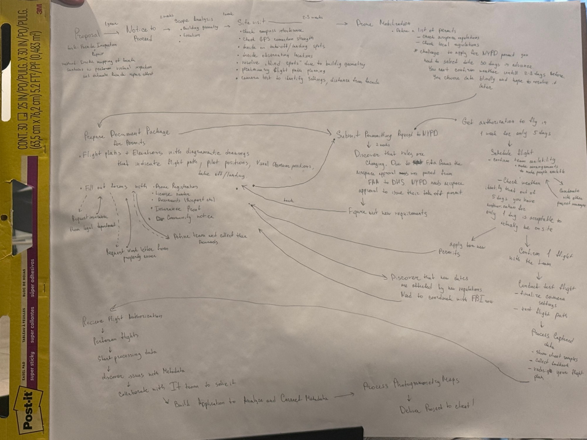

# Use case: drone facade inspection in New York City

_Captured 2026-11-14 from a team whiteboard session and the verbal walkthrough that went with it. Context for [plan.md](../../plan.md)._

## Summary

A real end-to-end drone project: facade inspection and repair estimate for a building in NYC. The work is not linear. Permits, weather, team availability, changing regulations, client feedback and data problems repeatedly send the team back to earlier steps. Decisions are often made with incomplete information (for example, picking a flight date 30 days ahead without knowing the weather) and have to be revisited later.

## Project

- **Task:** facade inspection and repair.
- **Method:** drone mapping of facade surfaces to perform a virtual inspection and estimate facade repair effort.

## Workflow as captured

Durations are the rough figures written on the whiteboard.

### 1. Proposal → Notice to Proceed (~1 year)

### 2. Scope analysis (~2 weeks)
- Building geometry
- Location

### 3. Site visit (~1 week)
- Check compass interference
- Check GPS connection strength
- Decide on take-off / landing spots
- Decide observation locations
- Resolve "blind spots" caused by building geometry (e.g. a tree between the drone position and the facade)
- Preliminary flight path planning
- Camera test to identify settings and distance from the facade

### 4. Drone mobilization (~2–3 weeks)
- Define a list of permits
  - Check airspace regulations
  - Check local regulations
- **Challenge:** to apply for an NYPD permit you must select the date **30 days in advance**, but weather can't be confirmed until **2–3 days before**. The date is chosen blindly, hoping to resolve it later.

### 5. Prepare the document package for permits
- Flight plans + elevations with diagrammatic drawings showing flight path, pilot positions, visual observer positions, take-off / landing
- Fill out forms with:
  - Drone registration
  - License number
  - Documents (passport etc.)
  - Insurance proof → request insurance from the legal department
  - Community notice
- Request a work letter from the property owner
- Define the team and collect their documents

### 6. Submit permitting request to NYPD (~2 weeks)
- **Challenge:** discover that the rules are changing. Because of the FIFA games (elevated security), airspace approval was passed from the **FAA to DHS**. NYPD now needs airspace approval before it can issue its take-off permit.
- Figure out the new requirements → **go back** to the document package and revise it → resubmit.
- **Challenge:** discover that the new dates are affected by new regulations → need to coordinate with the FBI too → **back** to the document package again.

### 7. Get authorization to fly (1 week from now, for only 5 days)

### 8. Schedule the flight
- **Confirm team availability.** The permit names specific people, so the team must reach out to other project managers to confirm availability, make arrangements, or reschedule.
- **Check weather.** Out of the 5 authorized days, only **1 day** meets the flight requirements.
- **Decision:** proceed with that 1 day as a **test flight**, and **apply for new permits** to secure more days, repeating the whole permitting loop.

### 9. Test flight (in parallel with the new permit loop)
- Confirm the flight with the team
- Conduct the test flight: finalize camera settings, test flight paths, collect test footage

### 10. Process captured test data
- Show the client samples
- Collect feedback: the client says this is not really what they want
- **Redesign the flight plan**, which loops back into planning and permits. More issues are discovered along the way that affect the cycle.

### 11. Receive flight authorization → perform flights

### 12. Data processing
- Start processing data in parallel with the flights
- **Challenge:** discover issues with the image metadata
- Collaborate with the IT team to solve it
- Build a separate application to analyze and correct the metadata → back to the start of processing

### 13. Process photogrammetry maps → deliver the project to the client

## Loops and rework

| Trigger | Sends the team back to |
| --- | --- |
| Permit date must be picked 30 days ahead; weather known only 2–3 days ahead | Re-applying for permits when the weather doesn't fit |
| Regulation change (FAA → DHS, NYPD needs airspace approval) | Revising the document package and resubmitting |
| New dates affected by new regulations; FBI coordination | Document package again |
| Only 1 of 5 authorized days has suitable weather | A new permit application for more days |
| Named team members unavailable | Coordination with other project managers; possible permit changes |
| Client rejects the test footage | Redesigning flight plans (and possibly permits) |
| Metadata problems in captured data | Building a fix tool, then restarting processing |

## What this means for our system

The whiteboard is essentially a decision lineage drawn by hand. Mapped to our model ([plan.md](../../plan.md)):

- **Source nodes:** NYPD / FAA / DHS rules, weather forecasts, team calendars, permit applications and authorizations, the property owner's letter, insurance, client feedback, test footage, image metadata.
- **Decisions made under uncertainty:** "fly on date X" is chosen 30 days ahead, before its key input (weather) exists. The system should record the decision **and** the inputs it was still waiting on, then flag it when the forecast arrives.
- **Stale decisions:** a regulation change makes the submitted permit package stale. That is exactly the stale-input check: a newer version of a regulation node arrived after the decision was made.
- **Agent suggestions with real value:**
  - "Only 1 of your 5 authorized days fits the wind and rain limits. Treat it as a test flight and start a new permit application now."
  - "This regulation changed after your submission; these 3 documents in your package are affected."
  - "Permit names Dev K., who is booked on another project Thursday. Contact their project manager."
  - "Last time a flight moved, the client was notified the same day."
- **Loops as versions:** each pass through the permit loop or flight-plan redesign is a new version of the same decision, with the reason for the change. The lineage timeline should make these loops visible, because they are where time and money go.
- **Parallel tracks:** test flight and new permit applications run at the same time. The canvas needs to show concurrent branches, not only a single line.
- **Lessons across projects:** the metadata issue and the FIFA-period rules are things the next project should be warned about early.

## Open questions

1. Which part of this workflow should the hackathon demo focus on: the permit/weather/team scheduling loop, the client feedback → redesign loop, or data processing?
2. What are the actual go/no-go limits (wind, rain, visibility) for facade inspection flights?
3. Which documents in the permit package are affected by which regulation changes? This is needed to show "what's affected" suggestions.
4. Can we get a sanitized version of a real permit timeline (dates, versions, rejections) to use as seed data?
