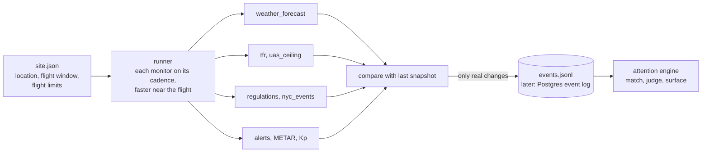

# Data sources and monitors for the facade survey

_Draft for team critique · 2026-11-14 · companion to [usecase-facade-survey.md](usecase-facade-survey.md) and [use-cases-and-decisions.md](use-cases-and-decisions.md)_

Every free source below was called live on 2026-11-14 from the venue and returned data, except where marked. Code for the monitors is in [`src/monitors/`](../src/monitors/README.md).

## 1. What we can monitor today, free, no key

| Need on the whiteboard | Source | Endpoint | What we get | Cadence | Monitor |
| --- | --- | --- | --- | --- | --- |
| "Only 1 of 5 days flyable" | [Open-Meteo](https://open-meteo.com/en/docs) forecast | `api.open-meteo.com/v1/forecast` | Hourly wind at 10/80/120 m, gusts, rain probability, visibility, cloud, sunrise/sunset, 16 days out | 1 h; 15 min within 3 days of a flight | `weather_forecast` |
| "Pick a permit date" (30 days ahead, blind) | Open-Meteo historical archive | `archive-api.open-meteo.com/v1/archive` | Past years' daily wind and rain for the same calendar weeks: the odds a day is flyable | On demand | `flyable_odds()` helper |
| Storms, wind advisories | [NWS API](https://www.weather.gov/documentation/services-web-api) | `api.weather.gov/alerts/active?point=` | Official watches and warnings at the site | 15 min | `weather_alerts` |
| Conditions right now | [Aviation Weather Center](https://aviationweather.gov/data/api/) | `aviationweather.gov/api/data/metar`, `/taf` | Observed and forecast wind, gusts, visibility, ceiling at KLGA, KJFK, KEWR | 30 min | `aviation_weather` |
| "President in town", UNGA, events | [FAA TFR list](https://tfr.faa.gov/) + TFR shapes | `tfr.faa.gov/tfrapi/getTfrList`, `tfr.faa.gov/geoserver/TFR/ows` (WFS, GeoJSON) | Every temporary flight restriction with its shape; we test distance to the site | 15 min | `tfr` |
| How high can we fly near LGA, JFK, EWR | [FAA UAS Facility Maps](https://www.faa.gov/uas/commercial_operators/uas_facility_maps) | ArcGIS FeatureServer `FAA_UAS_FacilityMap_Data` | LAANC grid ceiling (0 to 400 ft) around the site | Daily | `uas_ceiling` |
| "Airspace approval moved from FAA to DHS" | [Federal Register API](https://www.federalregister.gov/developers/documentation/api/v1) | `federalregister.gov/api/v1/documents.json` | New FAA, DHS and TSA rules and notices mentioning drones or UAS, with abstracts. Fed to the embedding match | 6 h | `regulations` |
| Street closures, parades, crowds near the site | [NYC Open Data](https://opendata.cityofnewyork.us/) permitted events (`tvpp-9vvx`) | `data.cityofnewyork.us/resource/tvpp-9vvx.json` | Permitted events by date, borough, street, closure type | 6 h | `nyc_events` |
| GPS reliability | [NOAA SWPC](https://www.swpc.noaa.gov/) planetary K index | `services.swpc.noaa.gov/products/noaa-planetary-k-index-forecast.json` | 3-day Kp forecast; Kp of 5 or more degrades GPS | 3 h | `space_weather` |
| Site address to coordinates | [NYC GeoSearch](https://geosearch.planninglabs.nyc/) | `geosearch.planninglabs.nyc/v2/search` | Coordinates, building ID (BIN) and lot (BBL) for an NYC address | Once per site | `site_context` |
| Building height and age | NYC building footprints (`5zhs-2jue`) | `data.cityofnewyork.us/resource/5zhs-2jue.json?bin=` | Roof height, ground elevation, year built, footprint. 120 Broadway: 544 ft, 1915 | Once per site | `site_context` |
| Neighbouring buildings, obstacles | [OpenStreetMap Overpass](https://wiki.openstreetmap.org/wiki/Overpass_API) | `overpass-api.de/api/interpreter` | Buildings, cranes, towers near the site. Needs a User-Agent header | On demand | not yet |

## 2. Worth adding, needs a key or sign-up

| Source | What it adds | Cost | Notes |
| --- | --- | --- | --- |
| [Google Maps Platform](https://developers.google.com/maps) | Geocoding outside NYC, Places, Elevation, Street View stills of the facade, Photorealistic 3D Tiles for the canvas | Free monthly credit, then pay per call | Needs a billing account and `GOOGLE_MAPS_API_KEY`. NYC GeoSearch covers geocoding for the demo |
| [FAA NOTAM API](https://api.faa.gov/) | All NOTAMs, not just TFRs (cranes, lighting outages, airspace changes) | Free | Requires an FAA developer account and approval, which may take days |
| [FAA B4UFLY / LAANC providers](https://www.faa.gov/uas/getting_started/b4ufly) (Aloft, Airspace Link) | Authorization requests and status | Partner agreements | Good for the roadmap; too slow to get for the weekend |
| Google Calendar / Microsoft Graph | Crew availability for "two of three crew are booked Wednesday" | Free | OAuth per user |
| Slack | Intake and the nanny | Free | Already planned; needs a workspace we can install into |
| Tomorrow.io, OpenWeather | Minute-level wind and a second forecast to cross-check | Free tiers | Open-Meteo is enough for the demo |

## 3. Not available as an API (watch by hand or by scraping, flag as risk)

- **NYPD drone permits and the NYC take-off permit process.** Status arrives by email: handle it through email intake (use case 10).
- **DHS or Secret Service restrictions before they become TFRs.** They show up in news and agency notices first; the regulations monitor plus news search is the best proxy.
- **Building owner, legal and insurer responses.** Tracked as blockers by the nanny, not by a feed.

## 4. How monitors feed the graph

- **Monitors only report changes.** Each keeps its last snapshot and emits an event when something that matters changed: a day's flyability flipped, a new TFR is within range, a new rule was published. "Nothing changed" emits nothing.
- **One event shape for every monitor**, matching the `data feed` node type and the event log decision (R1, L1): `source`, `kind`, `title`, `summary`, `severity_hint`, `valid_from`/`valid_to`, `location`, `dedupe_key`, `data`.
- **Monitors don't decide importance.** They give a `severity_hint` from simple rules (TFR over the site: high); the attention engine scores and routes.
- **Cadence tightens near the flight.** Forecasts and TFRs are checked every 15 minutes within 3 days of the flight window, hourly otherwise.

## 5. Open questions

1. **Flight limits:** what wind, gust, rain and visibility limits do our drone experts use for facade mapping? The defaults in `site.example.json` (sustained 20 mph, gusts 25 mph at 120 m, rain 30%, visibility 3 mi) are placeholders.
2. **Which rules feeds actually announced the FAA-to-DHS change?** If it wasn't the Federal Register, we need that source.
3. **Do we want Google Maps** for the 3D view and Street View stills? If so, someone needs to set up billing today.
