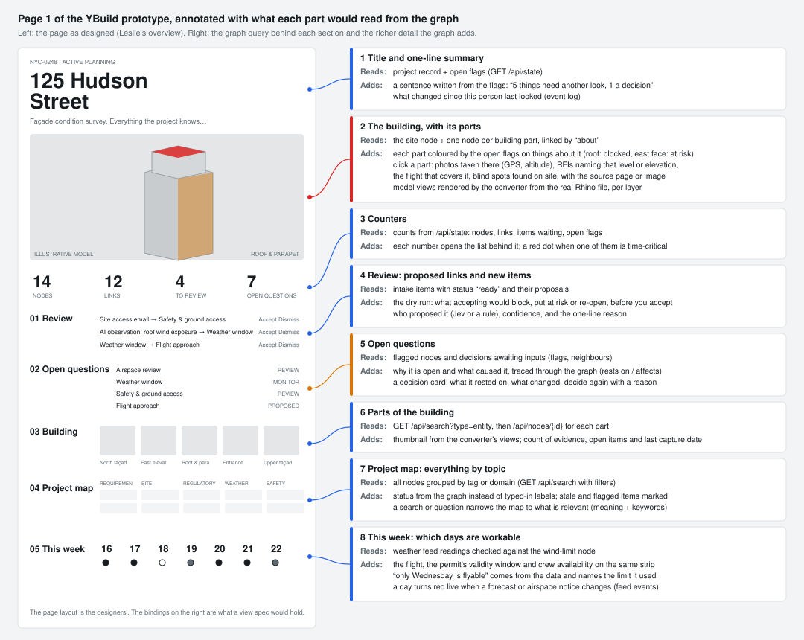
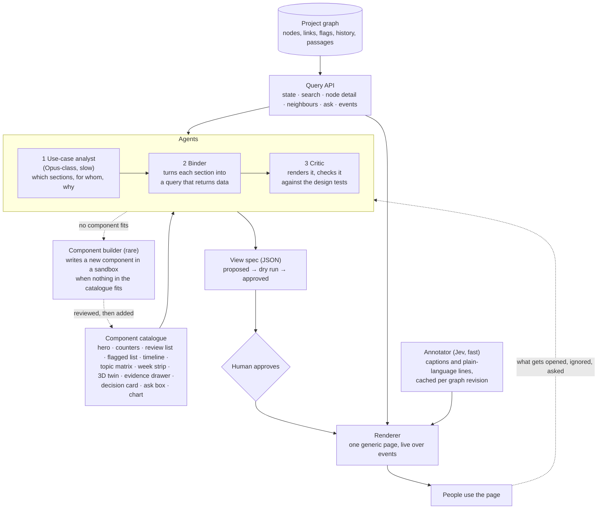

# Agents that build the UI for a use case, on top of the graph

_Draft for team critique · 2026-11-14 · companion to [agent-architecture.md](agent-architecture.md), [northstar/README.md](../src/northstar/README.md) and the front-end work under `web/`, `Leslie/` (branch `uix-design`) and `Grant/`_

**The idea in one paragraph.** The pages people use should be an *output* of the system, the same way rules are. For a given use case and role, an agent composes a page out of a catalogue of components, and binds each component to a query on the project graph. The result is a **view spec**: a small JSON document, not hand-written code. A generic renderer draws it with live data. A person approves the spec before anyone else sees it, and it lives in the decision history like everything else. The designers own the components and the visual language; the agents own which components appear, in what order, bound to what.

Everything here is **Proposed**.

## 1. Worked example: page 1 of the YBuild prototype

Leslie's overview page (the one with the building) is the target. Today it runs on sample data typed into the prototype. Below is the same page with each section tied to what it would read from the live graph, and what the graph adds that a static page can't show.



| # | Section on the page | Reads from the graph | What the graph adds |
| --- | --- | --- | --- |
| 1 | Title and one-line summary | Project record and open flags (`GET /api/state`) | A sentence written from the flags ("5 things need another look, 1 a decision"); what changed since this person last looked |
| 2 | **The building, with its parts** | The site node plus one node per building part (north façade, east elevation, roof and parapet, entrance, upper façade), linked by `about` | Each part coloured by the open flags on things about it. Clicking a part shows the photos taken there (GPS and altitude from the image metadata), RFIs that name that level or elevation, the flight that covers it, blind spots found on site, each with its source page or image. Model views come from the converter's renders of the real Rhino file, per layer |
| 3 | Counters | Counts from `/api/state` | Each number opens the list behind it; a marker when one is time-critical |
| 4 | Review: proposed links and new items | Intake items with status `ready` and their proposals | The dry run (what accepting would block, put at risk or re-open), who proposed it, confidence and reason |
| 5 | Open questions | Flagged nodes and decisions awaiting inputs (`flags`, `/api/nodes/{id}/neighbours`) | Why it is open and what caused it, traced through the graph; a decision card to decide again with a reason |
| 6 | Parts of the building | `GET /api/search?type=entity`, then `/api/nodes/{id}` per part | Thumbnail from the converter; counts of evidence, open items and last capture date |
| 7 | Project map: everything by topic | All nodes grouped by tag or domain (`/api/search` with filters) | Status from the graph, not typed-in labels; stale and flagged items marked; a question narrows the map to what is relevant |
| 8 | This week: which days are workable | Weather feed readings checked against the wind-limit node | The flight, the permit's validity window and crew on the same strip; "only Wednesday is flyable" derived from data and naming the limit used; a day turns red live when a feed changes |

Section 2 is the one that makes this page specific to a facade survey. A manufacturing project would put a layer-by-layer progress view there; a permit-heavy project would put the permit package. That is the part an agent should choose.

## 2. The view spec

A page is a list of sections. Each section names a component, binds it to a query, and says what to annotate and what actions it offers.

```json
{
  "id": "view_overview_pm",
  "use_case": "nyc-facade-survey",
  "role": "project_manager",
  "title": "Overview",
  "sections": [
    {
      "component": "twin-3d",
      "title": "Building",
      "bind": {
        "parts": {"query": "search", "params": {"type": "entity", "tags": ["building-part"]}},
        "model": {"query": "node", "ref": "site", "use": "converter.views"}
      },
      "annotate": [
        {"what": "colour", "by": "worst open flag on nodes about this part", "via": "neighbours(direction=any, depth=1) + flags"},
        {"what": "badge", "show": "count of evidence nodes", "via": "links_in where type = evidence_for or about"}
      ],
      "on_select": {"open": "evidence-drawer", "with": "node detail of the selected part"}
    },
    {
      "component": "week-strip",
      "title": "This week",
      "bind": {
        "days": {"query": "feed", "ref": "weather", "check_against": {"ref": "wind_limit"}},
        "overlays": [{"query": "search", "params": {"type": "event"}}, {"query": "node", "ref": "permit", "use": "valid_from,valid_to"}]
      },
      "annotate": [{"what": "caption", "write": "one sentence naming the workable days and the limit used", "by": "jev", "cache": "per graph revision"}]
    }
  ],
  "why": "PMs on facade surveys open the app to see which part of the building is in question and whether the flight window still holds.",
  "written_by": "analysis_loop",
  "status": "proposed | dry_run | active | retired"
}
```

Why a spec and not generated code:

- **Safe.** Nothing an agent writes runs in the browser. The renderer only draws known components with the result of known queries.
- **Explainable and diffable.** "Why is this section here?" has an answer (`why`), and a change to the page is a small diff in the history.
- **Portable.** The same spec format serves the facade survey, Ecem's manufacturing card and Grant's clinic example. Only the bindings and the choice of components change.
- **Cheap at render time.** No model call to draw a page; only the short written captions, cached per graph revision.

## 3. The pieces



| Piece | What it does | Speed |
| --- | --- | --- |
| **Query API** | The only way anything reads the graph. Already built: `/api/state`, `/api/search`, `/api/nodes/{id}`, `/api/nodes/{id}/neighbours`, `/api/ask`, `/api/events` | Milliseconds |
| **Component catalogue** | The designers' components, each with a declared data shape ("a list of items with title, status, reason") and the actions it can raise (accept, dismiss, decide, open evidence). Built once by the front end from Leslie's, Grant's and Elcin's work | n/a |
| **1. Use-case analyst** | Reads the use-case pack (node types, rules), the role, the graph and how past pages were used. Proposes the sections, their order and the reason for each. This is the analysis loop from [agent-architecture.md](agent-architecture.md), given one more thing to produce | Slow, rare |
| **2. Binder** | For each section, writes the query and checks it by running it: does it return the shape the component needs, and is it non-empty on this project? | Seconds |
| **3. Critic** | Renders the page headless with real data and checks it against Elcin's five questions (clarity, evidence, action, traceability, scope), empty states and accessibility. Sends problems back to the analyst | Seconds |
| **Annotator** | Writes the short human sentences: the one-line summary, "why this is flagged", the client's plain-language line. Jev, cached until the graph changes | About a second, cached |
| **Component builder** | Only when no component fits (say, a façade elevation heat-map). Writes a new component against the catalogue's contract in a sandbox, with screenshots and tests, for a front-end developer to review and merge | Minutes, human-reviewed |
| **Renderer** | One page that takes a view spec and live data and draws it. Re-reads on graph events | Milliseconds |

**The same life cycle as rules:** proposed, dry run on real data, approved by a person, active, measured, tuned or retired. A page section nobody opens is a candidate for removal; a question people keep asking the Ask box is a candidate for a new section.

## 4. What "rich features from the graph" means on a page

Things a hand-built page on sample data can't do, that every component can get from the graph:

| Feature | Where it comes from |
| --- | --- |
| **Live state:** blocked, at risk, re-opened, cleared | Open flags, updated over `/api/events` |
| **Why:** the reason and the chain that led to it | Flag reason plus `/api/nodes/{id}/neighbours?direction=rests_on` |
| **Evidence:** the exact page, image, layer or message | Passages with locators from the converter, via `/api/nodes/{id}` |
| **Provenance:** who added it, who approved it, proposed by which model or rule | Approvals and events |
| **Before you act:** what accepting or changing something would do | The dry run (`/api/items/{id}/preview`) |
| **Ask in context:** a question scoped to the selected part or node | `/api/search` and `/api/ask`, filtered to a node's neighbourhood |
| **Time:** how it looked at any earlier point | The event log and replay (now from the first node) |
| **Staleness and lineage:** a decision whose inputs moved on | Sharare's decision versions, once the app writes them |

## 5. What exists and what's missing

| Needed | Status |
| --- | --- |
| Query API | **Exists** (search, node detail, neighbours added today) |
| Component designs | **Exist** as prototypes: Leslie's React app (`uix-design`), Elcin's `web/` on the live API, Grant's pages |
| A catalogue with declared data shapes | Missing. The components exist but each fetches and shapes its own data |
| View spec format and renderer | Missing. `web/app.js` is close: its pages already read `/api/state`; they are hand-written, not spec-driven |
| Building parts in the graph | **Exists** (added after this was first written): five part nodes, `about` links, and `GET /api/parts` rolling flags up to a red / amber / none level per part. Still missing: linking photos to parts from their GPS and altitude |
| Analyst, binder, critic | Missing. The analysis loop exists for rules (`analysis.py`); view specs would be a second output |
| Feed readings as queryable data | Partly. Feed events exist; "per day, against the limit" needs a small endpoint |

## 6. A slice that fits before pencils down

Sunday 11:00 is the deadline, so this is deliberately small:

1. **Hand-write one view spec** for the overview page and a renderer that draws three sections from it (counters, flagged list, week strip) on the live API. This proves the binding idea with no agent involved.
2. **Add the building parts to the seed** (five entity nodes and `about` links) so section 2 has real data, and colour the parts by flags.
3. **One live agent beat:** ask the analyst for a view spec for a *different* role or use case (the pilot's go/no-go brief, or Ecem's manufacturing card), show the proposed spec and its reason, approve it, and watch the page appear.

If there is time for only one, do 2: the building lighting up when "drone 4a needs maintenance" is approved is the picture people will remember.

## 7. Open questions

1. **Who owns the catalogue?** It needs one front-end owner, and one visual language. Leslie's, Grant's and Elcin's work currently overlap.
2. **React or no-build?** Leslie's prototype is React + three.js; `web/` is plain JavaScript. The renderer has to pick one.
3. **How much can the analyst change?** Sections and order only, or also layout and density? Starting with sections and order keeps the designers in control of how things look.
4. **Per role or per person?** Role is enough for the hackathon. Per-person ordering ("Mary always opens permits first") is a later step.
5. **Where do view specs live?** Proposed: as rows next to rules, with the same proposed / dry run / active / retired states and approvals.
6. **Building parts for other use cases.** What plays the role of "the building" in manufacturing (the print, layer by layer?) or a clinic design (rooms and systems?). The drone experts and Ecem are best placed to answer.
